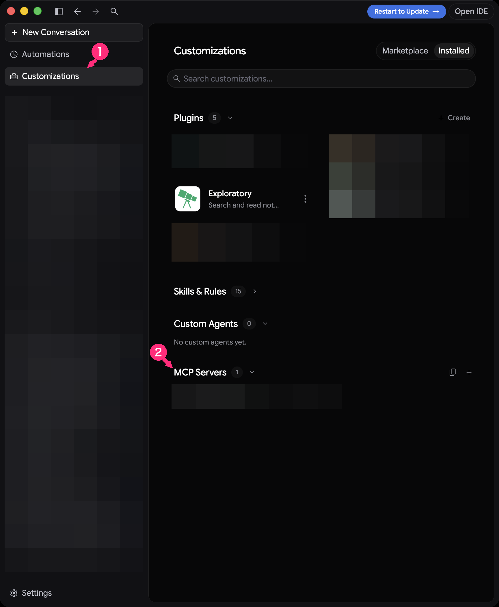

# Antigravity につなぐ

Antigravity に Exploratory のサーバーを登録し、ブラウザでサインインします。登録すると、AI から Exploratory に公開されたノートやデータを読めるようになります。かかる時間は 10 分ほどです。

<a id="need"></a>

## 必要なもの

- Exploratory のアカウント
- Antigravity
- API キーとクライアント ID は必要ありません。

<a id="steps"></a>

## 手順

### 設定ファイルの場所をコピーする

1. Antigravity のアプリで、サイドバーの「Customizations」を選び、「Installed」を選びます。
2. 「MCP Servers」の見出しにある「Copy Config File Path」を選ぶと、設定ファイル（mcp_config.json）の場所をコピーできます。



### サーバーを登録する

mcp_config.json を開き、次の内容を書き足します。リモートのサーバーは、「serverUrl」に URL を書きます。

**mcp_config.json**

```text
{
  "mcpServers": {
    "exploratory-server": {
      "serverUrl": "https://exploratory.io/mcp"
    }
  }
}
```

コマンドラインの agy で使うときは、~/.gemini/config/mcp_config.json に、同じ内容を書きます。

### サインインして許可する

1. 「MCP Servers」で、exploratory-server の横にある「Authenticate」を選びます。
2. ブラウザが開きます。Exploratory にサインインします。
3. Exploratory の同意画面で、アクセスを許可します。
4. ブラウザに表示された認可コードをコピーします。
5. 「Enter authorization code」の欄に、認可コードを貼り付けます。
6. 「Submit」を選びます。

サーバーは、自動でつなぎ直されます。サインインできたサーバーには、「Sign out」のボタンが表示されます。

agy で使うときは、次の順で行います。

1. agy を起動します。
2. /plugin を実行します。
3. exploratory-server の接続を開きます（Desktop プラグインの exploratory とは別です）。
4. Sign in を選びます。
5. Exploratory の同意画面で許可します。
6. ブラウザに表示された認可コードを、agy に貼り付けます。

### つながったことを確かめる

新しいチャットで、次のように送信します。

```text
Exploratory にある「Sales Orders」のデータを探して
```

Sales Orders のデータが URL つきで表示されれば、接続できています。

1. 検索結果の表にある「Sales Orders」のデータです。


<a id="plugin"></a>

## プラグインでインストールした場合の確かめ方

Exploratory のプラグインをインストールしたときは、「Customizations」の「Plugins」で「Exploratory」を開くと、接続の状態を確かめられます。「Accounts」のタブに、exploratory-server が「OAUTH」「CONNECTED」と表示されます。「MCP」のタブには、exploratory-server と、使えるツールの数（例: 「10 tools enabled」）が表示されます。

1. 「Accounts」のタブです。
2. 「CONNECTED」の表示です。


1. 「MCP」のタブです。
2. exploratory-server の行です。


<a id="trouble"></a>

## トラブルシューティング

| 表示される内容 | 対処 |
| --- | --- |
| サインインを求められる | 上のサインインの手順を、もう一度行います。 |
| Desktop のプラグインをインストールしたが、Server のツールが表示されない | Desktop のプラグイン exploratory は、Server とは別です。上の設定で、Server を登録します。 |

- [トラブルシューティング](../troubleshooting_ja.md) - MCP Server 全体の、症状ごとの対処です。

<a id="remove"></a>

## 接続を解除する

アプリでは、exploratory-server の横の「More actions」（⋮）を選び、「Delete」を選びます。一時的に止めるだけなら、「Disable」を選びます。mcp_config.json に追加した exploratory-server の部分を削除しても、解除できます。

登録を解除しても、アクセスの許可は残ります。許可も取り消すには、exploratory.io のアカウント設定の「接続中のAIアプリ」から、クライアントを解除します。
