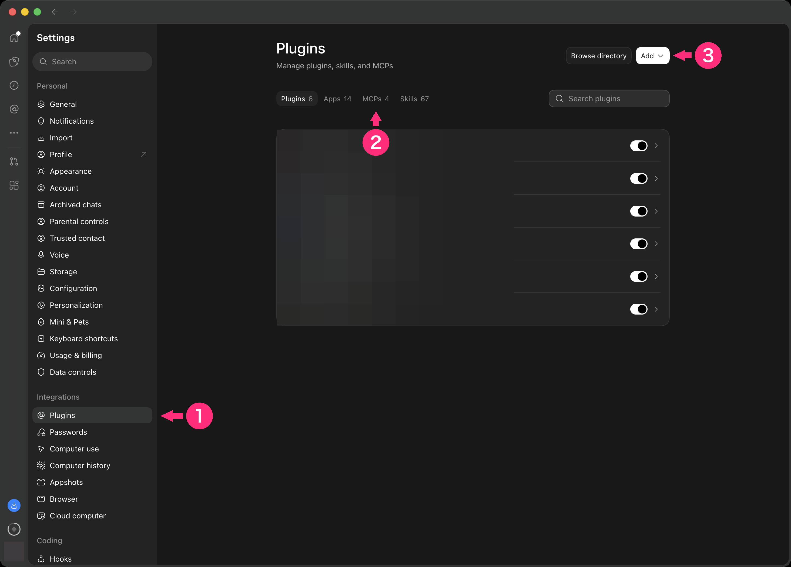
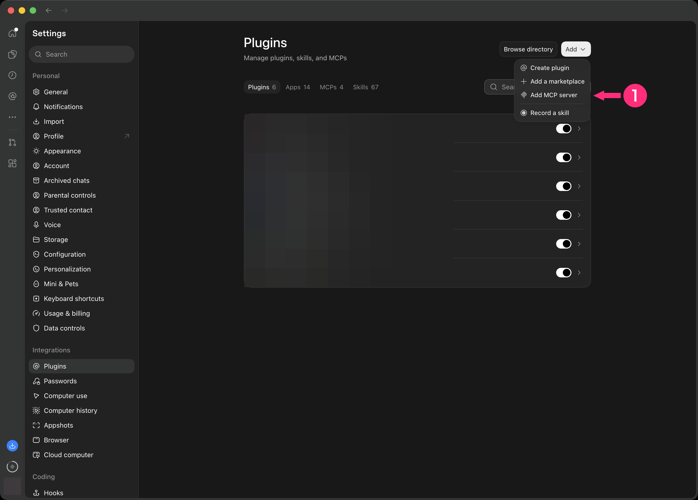
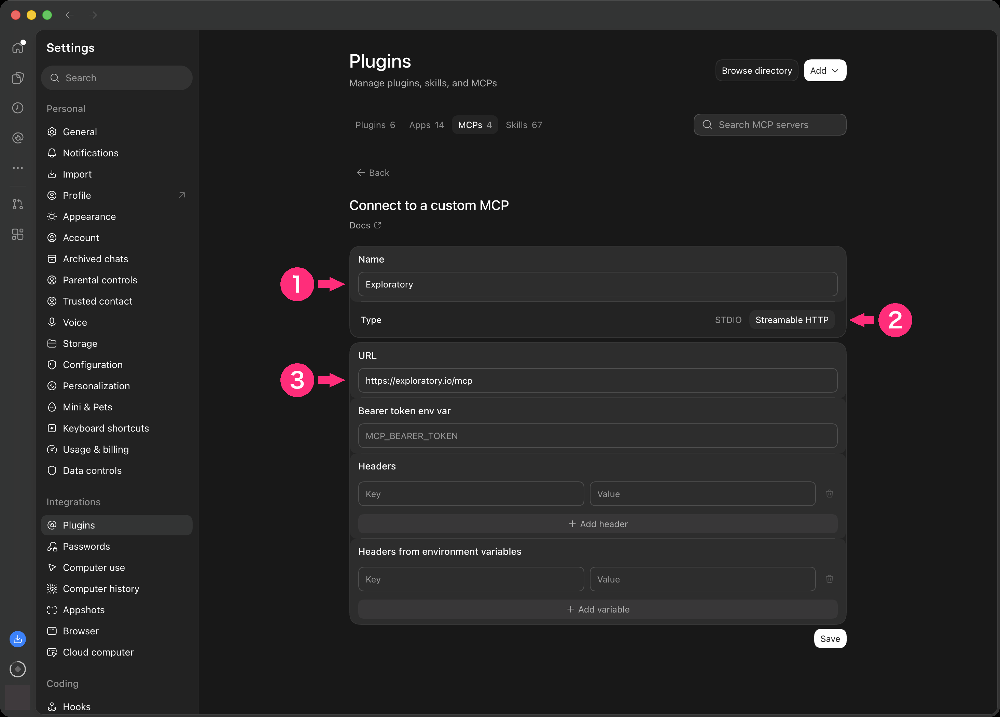
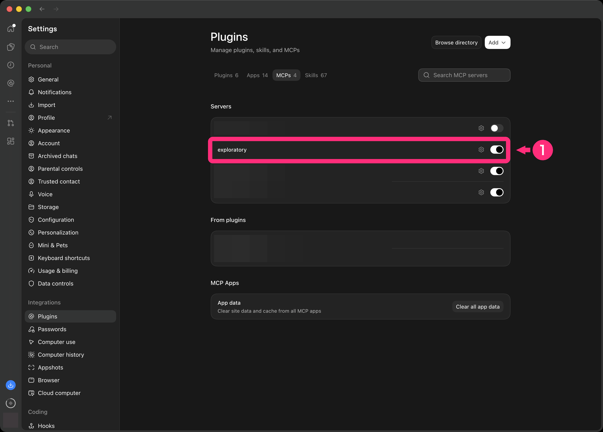
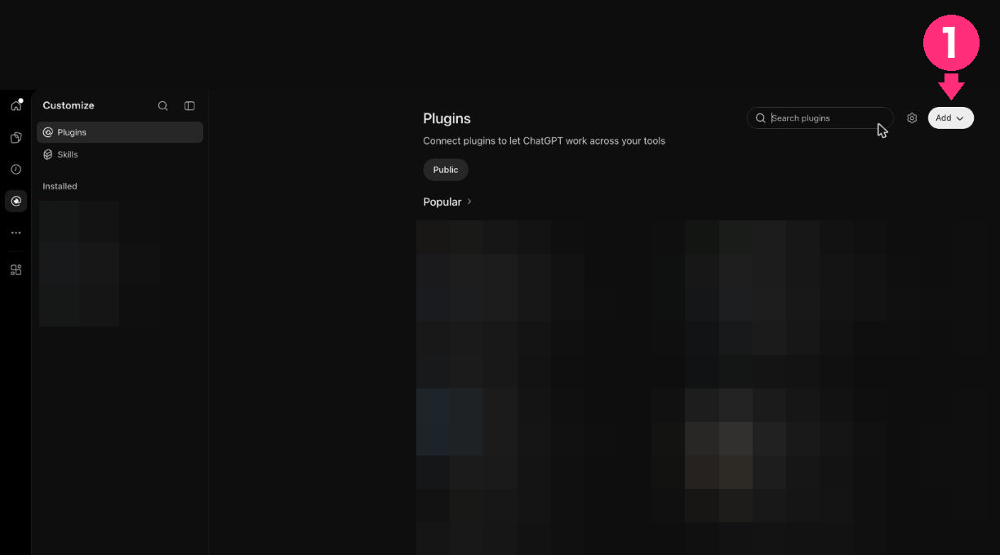
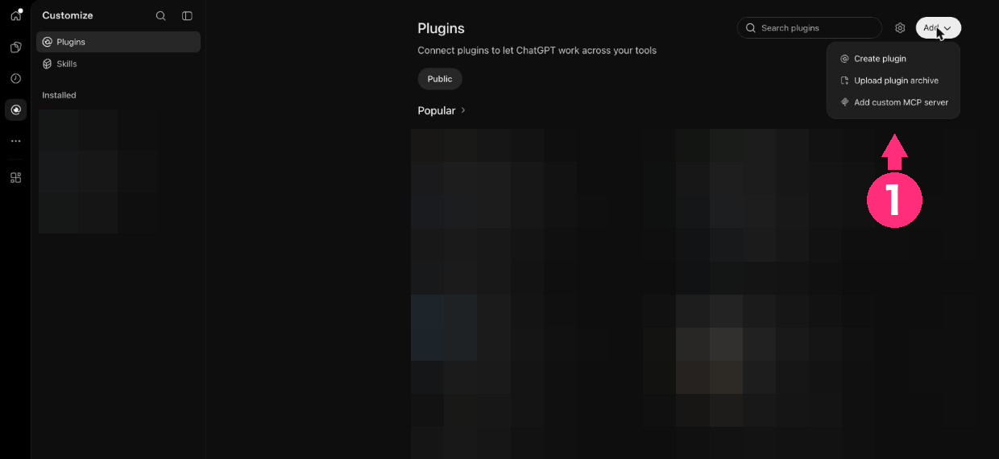
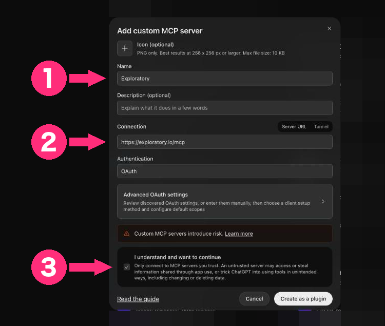
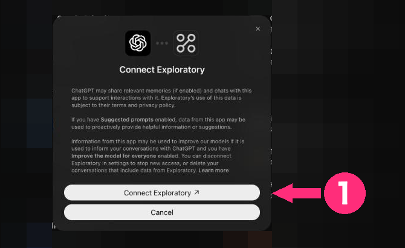

# Connect the ChatGPT app (desktop)

Add the Exploratory server to the ChatGPT desktop app as an MCP server. An MCP server is the address an AI app connects to in order to use the data and features of an outside service. After you add it, connect to Exploratory and approve the access, and ChatGPT can read notes and data published on Exploratory.

On the web (chatgpt.com), the screens for adding a server differ. The web steps are further down this page. It takes about 5 minutes.

<a id="need"></a>

## Requirements

- An Exploratory account
- The ChatGPT desktop app

You do not need an API key or a client ID.

<a id="steps"></a>

## Steps (desktop app)

### Open settings

In the ChatGPT desktop app, open settings.

1. In the menu on the left of settings, choose Plugins under Integrations.
2. Among the tabs Plugins, Apps, MCPs and Skills, choose MCPs.
3. Choose Add at the top right.



The Add menu opens.

1. Choose Add MCP server. The Connect to a custom MCP screen opens.



### Enter the address and save

1. In Name, enter the name to show in the list, for example Exploratory.
2. For Type, choose Streamable HTTP. Do not choose STDIO.
3. In URL, enter this URL.

   ```text
   https://exploratory.io/mcp
   ```



You can leave the other fields (Bearer token env var, Headers and so on) empty. Exploratory connects through a sign-in in your browser, so it needs no token and no header. When you have entered the values, choose Save at the bottom right.

### Restart and approve the access on exploratory.io

The [official documentation](https://learn.chatgpt.com/docs/extend/mcp) describes what to do after you save as follows. The labels are quoted as the documentation writes them.

1. Restart the ChatGPT desktop app, following the documentation's Restart instruction.
2. For a server that needs OAuth, the list of servers shows that. When it does, choose Authenticate, as the documentation says.
3. Your browser opens exploratory.io. If you are not signed in, sign in first.
4. On the screen where ChatGPT asks for access, choose Allow.


### Check that it is connected

If the server you added appears under Servers on the MCPs tab, it was added.

1. The row you added in the list of servers.



Type `/mcp` in the chat box to see the connected servers. Then open a new chat and send this.

```text
Find the "Sales Orders" data on Exploratory.
```

If the Sales Orders data appears with its URL, it works.

<a id="web"></a>

## Add it on the web (chatgpt.com)

On the web, the screens for adding a server differ from the desktop app. This section describes the web steps.

### Open the Plugins screen

In ChatGPT, open Settings.

1. Choose Plugins in Settings.
2. Choose Browse directory. The Plugins screen under Customize opens.


On the Plugins screen under Customize, open the Add menu.

1. Choose Add at the top right.



The menu opens.

1. Choose Add custom MCP server.



### Enter the address and create it

On the Add custom MCP server screen, enter these values.

1. In Name, enter the name to show in the list, for example Exploratory.
2. Under Connection, leave Server URL selected. In the URL field, enter this URL.

   ```text
   https://exploratory.io/mcp
   ```

3. The screen says "Custom MCP servers introduce risk." Make sure you trust the server, then select I understand and want to continue.



Also check that Authentication is OAuth. There is nothing to change. Then choose Create as a plugin.

### Approve the access on exploratory.io

The Connect Exploratory screen opens.

1. Choose the Connect Exploratory button.



Your browser opens exploratory.io. If you are not signed in, sign in first.

1. On the screen where ChatGPT asks for access, choose Allow.


This screen of exploratory.io is shown in Japanese.

### Check that it is connected

Back in ChatGPT, Exploratory appears under Installed on the left of Customize. Open Exploratory to see its details.

1. The Exploratory row under Apps. The Developer field is blurred in the image.


Information lists Developer, Category, Version and Website.

Choose Try in chat to open a chat. Send this.

```text
Find the "Sales Orders" data on Exploratory.
```

If the Sales Orders data appears with its URL, it works.

<a id="trouble"></a>

## If it does not work

For other symptoms, see [Troubleshooting](../troubleshooting.md).

<a id="remove"></a>

## Disconnect

In the desktop app, turn off the switch of the server you added under Servers on the MCPs tab, and it is no longer used. On the web, delete the Exploratory plugin you added in the plugin list. Then open Account Settings on exploratory.io and remove the app you connected under Connected AI Apps. Deleting it in ChatGPT alone does not revoke the access you approved on Exploratory.
