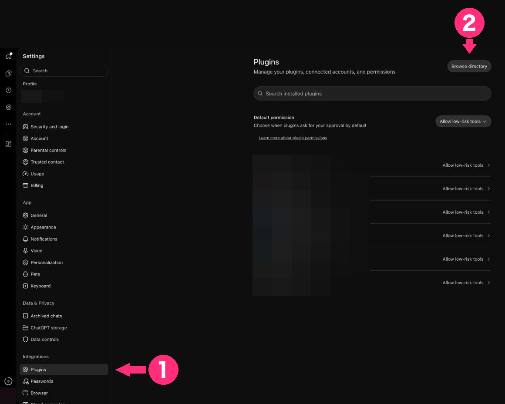
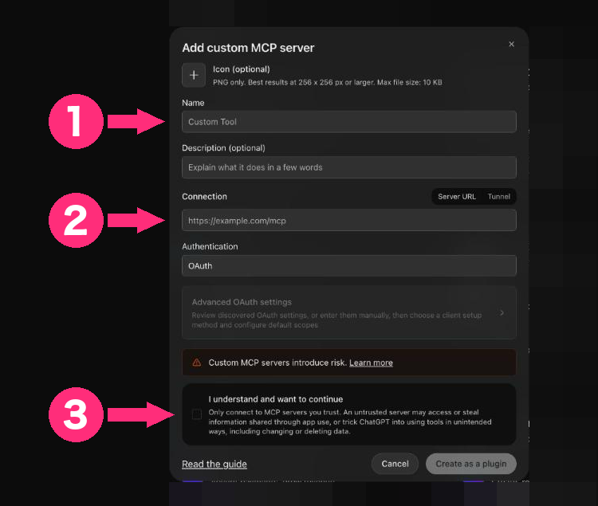
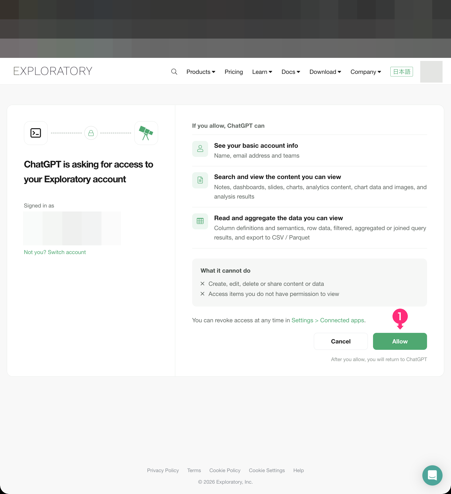
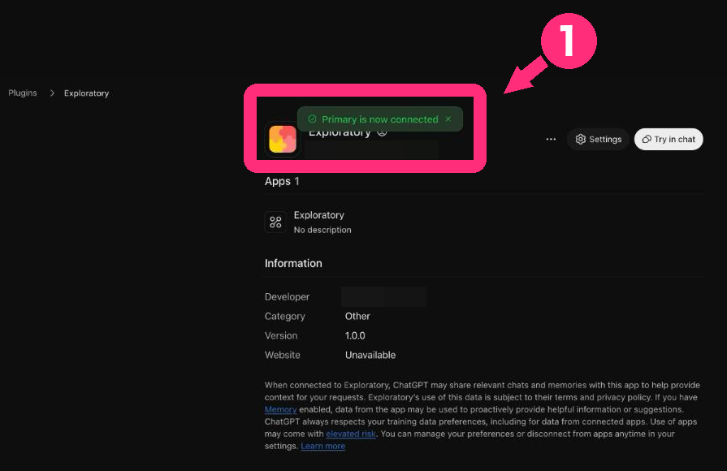

# Connect the ChatGPT app (desktop and web)

Add the Exploratory server to ChatGPT as a custom MCP server. An MCP server is the address an AI app connects to in order to use the data and features of an outside service. After you add it, connect to Exploratory and approve the access, and ChatGPT can read notes and data published on Exploratory.

You can make the same settings in the ChatGPT desktop app and on the web.

<a id="need"></a>

## Requirements

- An Exploratory account
- The ChatGPT desktop app, or the web version

You do not need an API key or a client ID.

<a id="steps"></a>

## Steps

### 1. Open settings

In ChatGPT, open Settings.

### 2. Choose Plugins

Choose Plugins in Settings.



In the image, 1 is Plugins and 2 is Browse directory.

### 3. Open the plugin list

Choose Browse directory. The Plugins screen under Customize opens.


In the image, 1 is Add.

### 4. Choose Add

Choose Add at the top right.

### 5. Choose Add custom MCP server

In the menu, choose Add custom MCP server.


In the image, 1 is Add custom MCP server.

### 6. Enter the name

In Name, enter the name to show in the list, for example Exploratory.



In the image, 1 is Name, 2 is the Server URL field and 3 is the check box I understand and want to continue.

### 7. Enter the URL

Under Connection, leave Server URL selected. In the URL field, enter this URL.

```text
https://exploratory.io/mcp
```

### 8. Check the authentication

Check that Authentication is OAuth. There is nothing to change.

### 9. Read the warning and select the check box

The screen says "Custom MCP servers introduce risk." Make sure you trust the server, then select I understand and want to continue.


In the image, 1 is Name, 2 is the Server URL field and 3 is the check box I understand and want to continue.

### 10. Create it

Choose Create as a plugin.

### 11. Connect to Exploratory

The Connect Exploratory screen opens. Choose the Connect Exploratory button.


In the image, 1 is the Connect Exploratory button.

### 12. Approve the access

Your browser opens exploratory.io. If you are not signed in, sign in first. On the screen where ChatGPT asks for access, choose Allow.



In the image, 1 is the approval button (Allow). This screen of exploratory.io is shown in Japanese.

### 13. Check that it is connected

Back in ChatGPT, Exploratory appears under Installed on the left of Customize. Open Exploratory to see its details: the Exploratory row under Apps, and Information. Information lists Developer, Category, Version and Website.



In the image, 1 is the Exploratory row under Apps. The Developer field is blurred in the image.

### 14. Try it

Choose Try in chat to open a chat. Send this.

```text
Find the "Sales Orders" data on Exploratory.
```

If the Sales Orders data appears with its URL, it works.

<a id="trouble"></a>

## If it does not work

For other symptoms, see [Troubleshooting](../troubleshooting.md).

<a id="remove"></a>

## Disconnect

In the ChatGPT plugin list, delete the Exploratory plugin you added. Then open Account Settings on exploratory.io and remove the app you connected under Connected AI Apps. Deleting it in ChatGPT alone does not revoke the access you approved on Exploratory.
