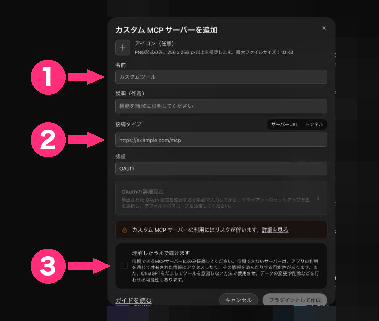
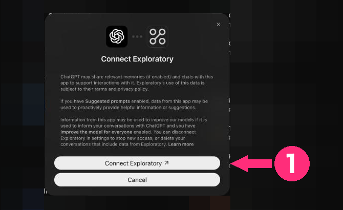
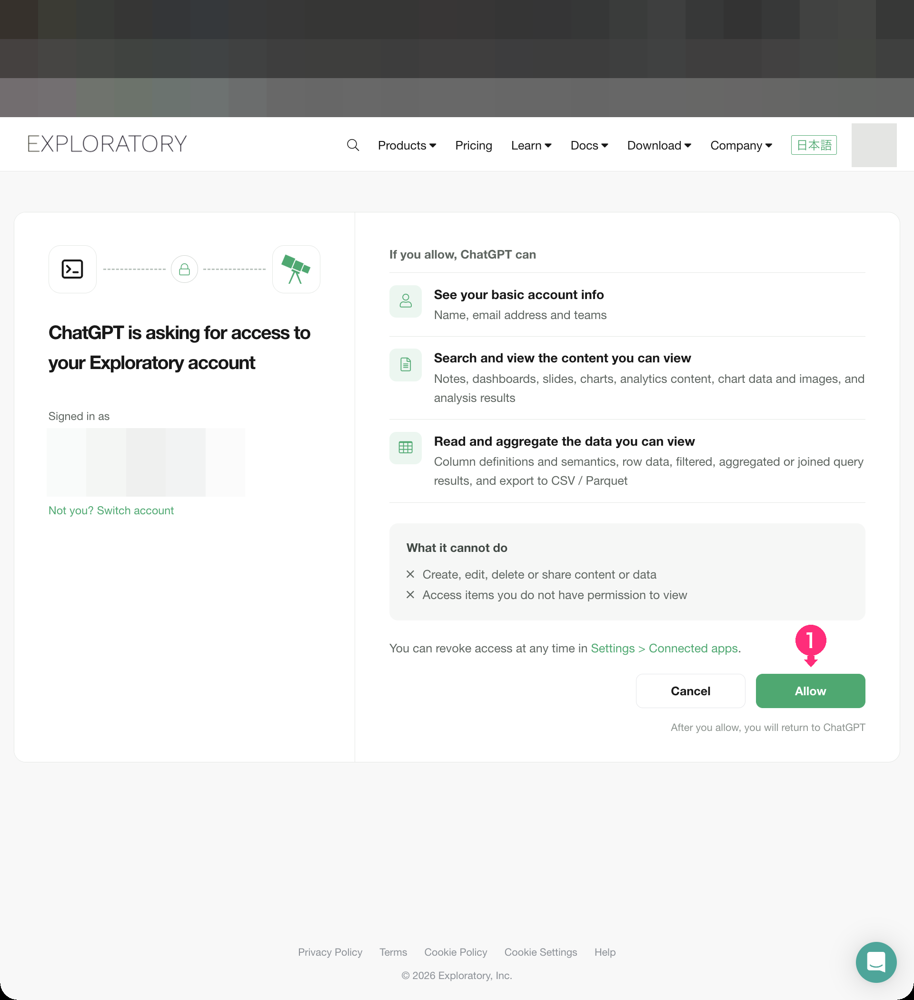

# ChatGPT アプリにつなぐ（デスクトップ・Web 共通）

ChatGPT に、Exploratory のサーバーを「カスタム MCP サーバー」として追加します。MCP サーバーとは、AI アプリが外部のサービスのデータや機能を使うための接続先です。追加したあと、Exploratory に接続して許可すると、ChatGPT から、Exploratory に公開されたノートやデータを読めるようになります。

ChatGPT のデスクトップアプリでも、Web 版でも、同じ設定ができます。

<a id="need"></a>

## 必要なもの

- Exploratory のアカウント
- ChatGPT のデスクトップアプリ、または Web 版

API キーやクライアント ID は要りません。

<a id="steps"></a>

## 手順

### 1. 設定を開く

ChatGPT で、設定を開きます。

### 2. 「プラグイン」を選ぶ

設定の「プラグイン」を選びます。


画像の 1 は「プラグイン」、2 は「エージェント一覧を見る」です。

### 3. 「エージェント一覧を見る」を選ぶ

「エージェント一覧を見る」を選びます。カスタマイズの「プラグイン」の画面が開きます。


画像の 1 は「追加」です。

### 4. 「追加」を選ぶ

右上の「追加」を選びます。

### 5. 「カスタム MCP サーバーを追加」を選ぶ

メニューの「カスタム MCP サーバーを追加」を選びます。


画像の 1 は「カスタム MCP サーバーを追加」です。

### 6. 名前を入力する

「カスタム MCP サーバーを追加」の画面で、「名前」に、一覧に表示する名前（例: Exploratory）を入力します。



画像の 1 は「名前」、2 は「サーバーURL」の欄、3 は「理解したうえで続けます」のチェックです。

### 7. URL を入力する

「接続タイプ」は、「サーバーURL」を選んだままにします。URL の欄に、次の URL を入力します。

```text
https://exploratory.io/mcp
```

### 8. 認証を確かめる

「認証」が「OAuth」になっていることを確かめます。変えるところはありません。

### 9. 注意を確かめて、チェックを入れる

「カスタム MCP サーバーの利用にはリスクが伴います。」と表示されます。接続先を信頼できることを確かめて、「理解したうえで続けます」にチェックを入れます。


画像の 1 は「名前」、2 は「サーバーURL」の欄、3 は「理解したうえで続けます」のチェックです。

### 10. 作成する

「プラグインとして作成」を選びます。

### 11. Exploratory に接続する

接続の画面が開きます。次の画像は、英語の画面で、日本語の画面ではありません。画面には、「Connect Exploratory」という見出しとボタンが表示されます。ボタンを選びます。



画像の 1 は「Connect Exploratory」のボタンです。この画像は、英語の画面です。

### 12. 許可する

ブラウザで exploratory.io が開きます。サインインしていないときは、先にサインインします。ChatGPT がアクセスを求めている画面で、「許可する」を選びます。



画像の 1 は「許可する」です。

### 13. 接続されたことを確かめる

ChatGPT に戻ると、カスタマイズの左の「インストール済み」に「Exploratory」が表示されます。「Exploratory」を開くと、詳細画面に、「アプリ」の下の「Exploratory」の行と、「情報」が表示されます。「情報」には、開発者、カテゴリ、バージョン、ウェブサイトが並びます。


画像の 1 は、「アプリ」の下の「Exploratory」の行です。画像では、開発者の欄をぼかしています。

### 14. 試す

詳細画面の「チャットで試す」を選んで、チャットを開きます。次のように送信します。

```text
Exploratory にある「Sales Orders」のデータを探して
```

Sales Orders のデータが URL つきで表示されれば、使えています。

<a id="trouble"></a>

## うまくいかないとき

ほかの症状は、[トラブルシューティング](../troubleshooting_ja.md) を参照してください。

<a id="remove"></a>

## 接続を解除する

ChatGPT のプラグインの一覧で、追加した「Exploratory」を削除します。そのあと、exploratory.io の「アカウント設定」を開き、「接続中のAIアプリ」から、接続したアプリを解除します。ChatGPT で削除しただけでは、Exploratory 側のアクセスの許可は残ります。
