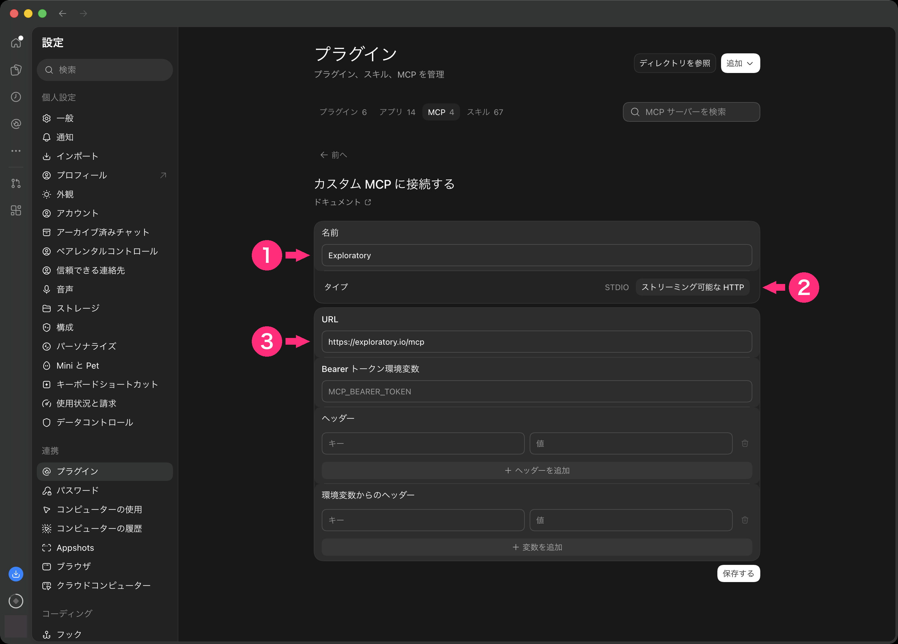
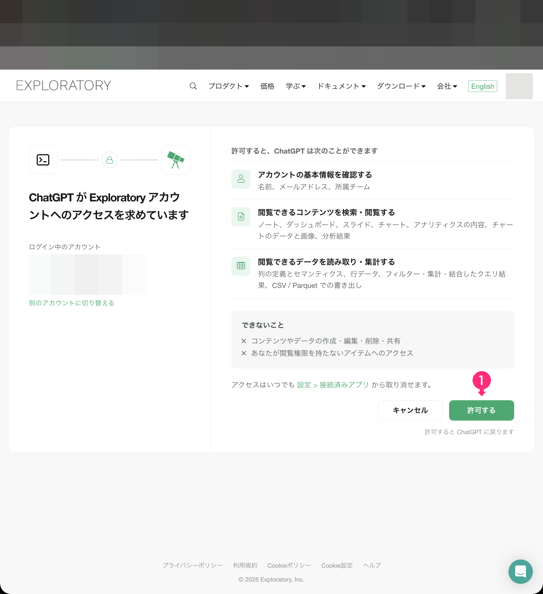
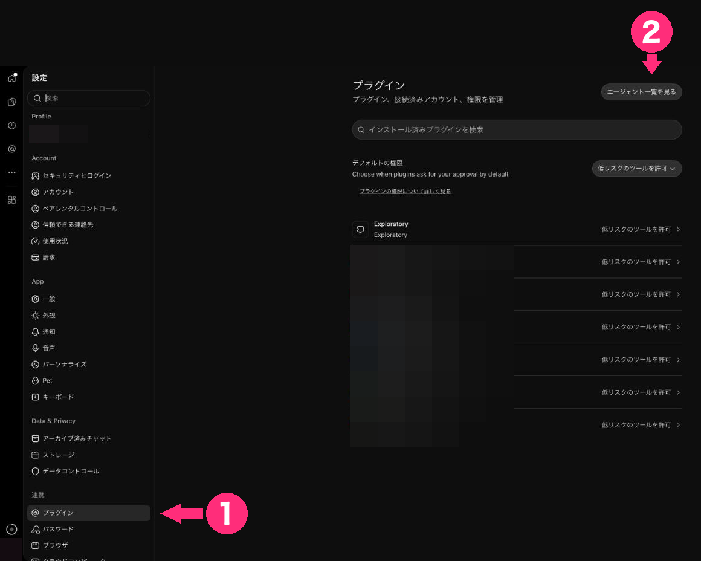
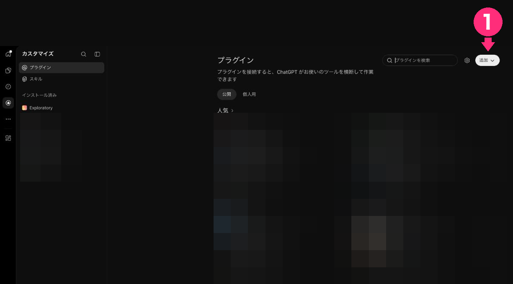
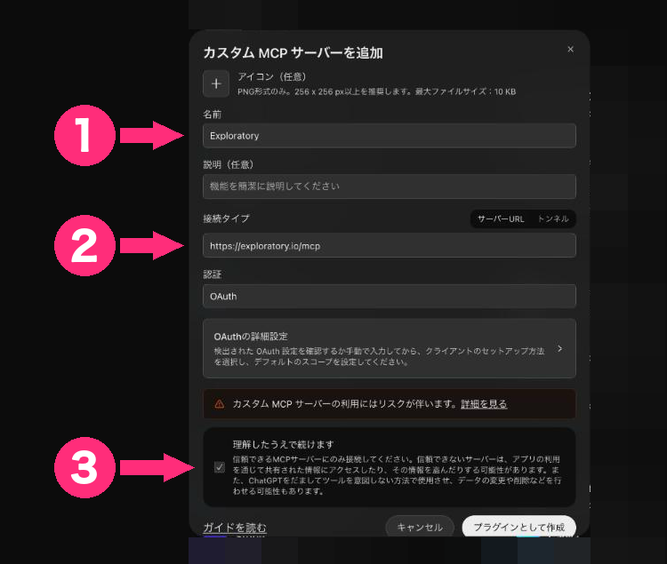

# ChatGPT アプリ（デスクトップ）につなぐ

ChatGPT のデスクトップアプリに、Exploratory のサーバーを「MCP サーバー」として追加します。MCP サーバーとは、AI アプリが外部のサービスのデータや機能を使うための接続先です。追加したあと、Exploratory に接続して許可すると、ChatGPT から、Exploratory に公開されたノートやデータを読めるようになります。

Web 版（chatgpt.com）では、追加の画面が違います。Web 版の手順は、このページの後ろにあります。かかる時間は 5 分ほどです。

<a id="need"></a>

## 必要なもの

- Exploratory のアカウント
- ChatGPT のデスクトップアプリ

API キーやクライアント ID は要りません。

<a id="steps"></a>

## 手順（デスクトップアプリ）

### 設定を開く

ChatGPT のデスクトップアプリで、設定を開きます。

1. 設定の左のメニューで、「連携」の中の「プラグイン」を選びます。
2. 「プラグイン」「アプリ」「MCP」「スキル」と並ぶタブから、「MCP」を選びます。
3. 右上の「追加」を選びます。


「追加」のメニューが開きます。

1. 「MCP サーバーを追加」を選びます。「カスタム MCP に接続する」の画面が開きます。


### 接続先を入力して保存する

1. 「名前」に、一覧に表示する名前（例: Exploratory）を入力します。
2. 「タイプ」で、「ストリーミング可能な HTTP」を選びます。「STDIO」は選びません。
3. 「URL」に、次の URL を入力します。

   ```text
   https://exploratory.io/mcp
   ```



ほかの欄（「Bearer トークン環境変数」「ヘッダー」など）は、空欄のままで構いません。ブラウザでのサインインで接続するため、トークンやヘッダーは要りません。入力できたら、右下の「保存する」を選びます。

### 再起動して exploratory.io で許可する

[公式の資料](https://learn.chatgpt.com/docs/extend/mcp)では、保存したあとを次のように案内しています。画面の文言は、資料の表記のまま引いています。

1. 資料の「Restart」（再起動）の案内に従って、ChatGPT のデスクトップアプリを再起動します。
2. 認証（OAuth）が必要なサーバーは、サーバーの一覧に、そのことが表示されます。表示されたら、資料の「Authenticate」（認証）を選びます。
3. ブラウザで exploratory.io が開きます。サインインしていないときは、先にサインインします。
4. ChatGPT がアクセスを求めている画面で、「許可する」を選びます。



### つながったことを確かめる

「MCP」のタブの「サーバー」の一覧に、追加したサーバーが表示されていれば、追加できています。

1. サーバーの一覧の、追加した行です。


チャットの入力欄に `/mcp` と入力すると、接続しているサーバーを確認できます。続けて、新しいチャットを開き、次のように送信します。

```text
Exploratory にある「Sales Orders」のデータを探して
```

Sales Orders のデータが URL つきで表示されれば、使えています。

<a id="web"></a>

## Web 版（chatgpt.com）で追加する

Web 版では、追加の画面が、デスクトップアプリと違います。ここでは、Web 版の手順を説明します。

### プラグインの画面を開く

ChatGPT で、設定を開きます。

1. 設定の「プラグイン」を選びます。
2. 「エージェント一覧を見る」を選びます。カスタマイズの「プラグイン」の画面が開きます。



カスタマイズの「プラグイン」の画面で、追加のメニューを開きます。

1. 右上の「追加」を選びます。



メニューが開きます。

1. 「カスタム MCP サーバーを追加」を選びます。


### 接続先を入力して作成する

「カスタム MCP サーバーを追加」の画面で入力します。

1. 「名前」に、一覧に表示する名前（例: Exploratory）を入力します。
2. 「接続タイプ」は「サーバーURL」を選んだままにして、URL の欄に、次の URL を入力します。

   ```text
   https://exploratory.io/mcp
   ```

3. 「カスタム MCP サーバーの利用にはリスクが伴います。」と表示されます。接続先を信頼できることを確かめて、「理解したうえで続けます」にチェックを入れます。



「認証」が「OAuth」になっていることも確かめます。変えるところはありません。確かめたら、「プラグインとして作成」を選びます。

### exploratory.io で許可する

接続の画面が開きます。次の画像は、英語の画面で、日本語の画面ではありません。

1. 「Connect Exploratory」のボタンを選びます。


ブラウザで exploratory.io が開きます。サインインしていないときは、先にサインインします。

1. ChatGPT がアクセスを求めている画面で、「許可する」を選びます。


### つながったことを確かめる

ChatGPT に戻ると、カスタマイズの左の「インストール済み」に「Exploratory」が表示されます。「Exploratory」を開くと、詳細画面が表示されます。

1. 「アプリ」の下の「Exploratory」の行です。画像では、開発者の欄をぼかしています。


「情報」には、開発者、カテゴリ、バージョン、ウェブサイトが並びます。

詳細画面の「チャットで試す」を選んで、チャットを開きます。次のように送信します。

```text
Exploratory にある「Sales Orders」のデータを探して
```

Sales Orders のデータが URL つきで表示されれば、使えています。

<a id="trouble"></a>

## うまくいかないとき

ほかの症状は、[トラブルシューティング](../troubleshooting_ja.md) を参照してください。

<a id="remove"></a>

## 接続を解除する

デスクトップアプリでは、「MCP」のタブの「サーバー」の一覧で、追加したサーバーのスイッチをオフにすると、使われなくなります。Web 版では、プラグインの一覧で、追加した「Exploratory」を削除します。そのあと、exploratory.io の「アカウント設定」を開き、「接続中のAIアプリ」から、接続したアプリを解除します。ChatGPT で削除しただけでは、Exploratory 側のアクセスの許可は残ります。
