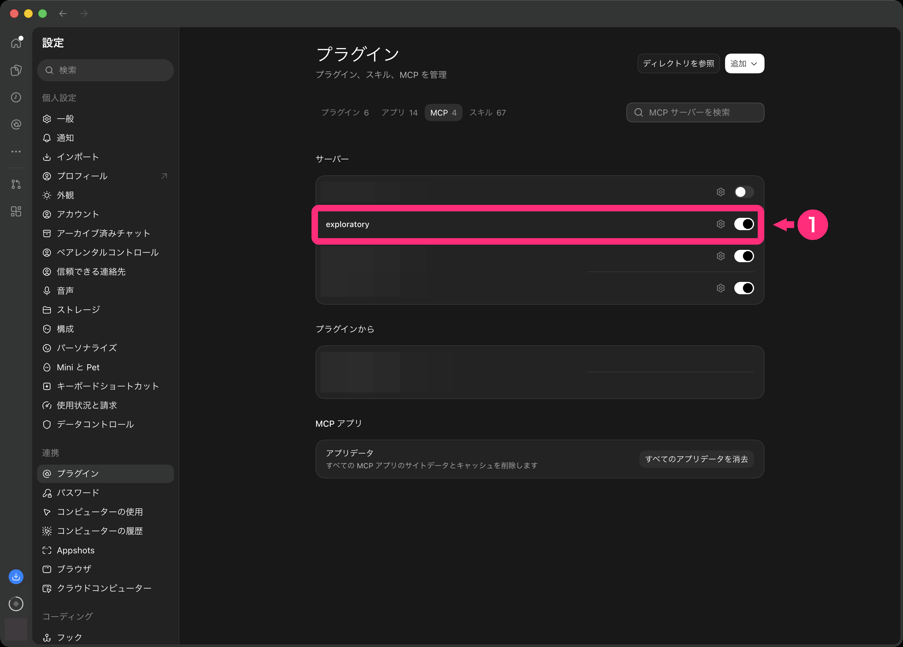
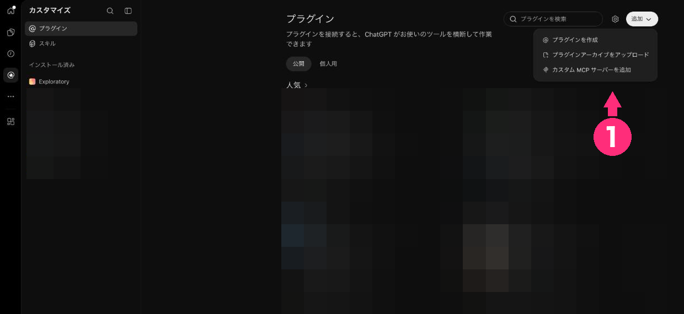
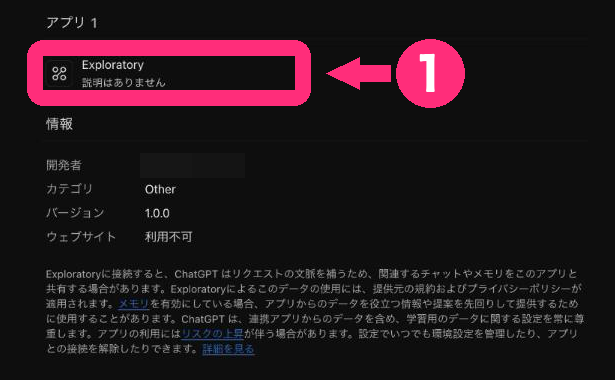

# ChatGPT アプリ（デスクトップ）につなぐ

ChatGPT のデスクトップアプリに、Exploratory のサーバーを「MCP サーバー」として追加します。MCP サーバーとは、AI アプリが外部のサービスのデータや機能を使うための接続先です。追加したあと、Exploratory に接続して許可すると、ChatGPT から、Exploratory に公開されたノートやデータを読めるようになります。

Web 版（chatgpt.com）では、追加の画面が違います。Web 版の手順は、このページの後ろにあります。

<a id="need"></a>

## 必要なもの

- Exploratory のアカウント
- ChatGPT のデスクトップアプリ

API キーやクライアント ID は要りません。

<a id="steps"></a>

## 手順（デスクトップアプリ）

### 1. 設定を開く

ChatGPT のデスクトップアプリで、設定を開きます。

### 2. 「プラグイン」を選ぶ

設定の左のメニューで、「連携」の中の「プラグイン」を選びます。

### 3. 「MCP」のタブを選ぶ

「プラグイン」「アプリ」「MCP」「スキル」と並ぶタブから、「MCP」を選びます。


画像の 1 は手順 2 の「プラグイン」、2 は手順 3 の「MCP」のタブ、3 は手順 4 の「追加」です。

### 4. 「追加」を選ぶ

右上の「追加」を選びます。

### 5. 「MCP サーバーを追加」を選ぶ

メニューの「MCP サーバーを追加」を選びます。「カスタム MCP に接続する」の画面が開きます。


画像の 1 は「MCP サーバーを追加」です。

### 6. 名前を入力する

「名前」に、一覧に表示する名前（例: Exploratory）を入力します。

### 7. タイプを選ぶ

「タイプ」で、「ストリーミング可能な HTTP」を選びます。「STDIO」は選びません。

### 8. URL を入力する

「URL」に、次の URL を入力します。

```text
https://exploratory.io/mcp
```

### 9. そのほかの欄を空のままにする

「Bearer トークン環境変数」と「ヘッダー」は、空のままにします。Exploratory には、ブラウザでサインインして接続するので、トークンやヘッダーは要りません。


画像の 1 は手順 6 の「名前」、2 は手順 7 の「タイプ」、3 は手順 8 の「URL」です。

### 10. 「保存する」を選ぶ

右下の「保存する」を選びます。「MCP」のタブの「サーバー」の一覧に、追加したサーバーが表示されます。



画像の 1 は、サーバーの一覧の行です。

公式の資料では、ここから先を次のように案内しています。画面の文言は、資料の表記のまま引いています。

### 11. 再起動する

保存したあとは、ChatGPT のデスクトップアプリを、資料の「Restart」（再起動）の案内に従って再起動します。

### 12. 認証する

認証（OAuth）が必要なサーバーは、サーバーの一覧に、そのことが表示されます。表示されたら、資料の「Authenticate」（認証）を選びます。

### 13. 許可する

ブラウザで exploratory.io が開きます。サインインしていないときは、先にサインインします。ChatGPT がアクセスを求めている画面で、「許可する」を選びます。


画像の 1 は「許可する」です。

### 14. 接続を確かめる

チャットの入力欄に `/mcp` と入力すると、接続しているサーバーを確認できます。

### 15. 試す

新しいチャットで、次のように送信します。

```text
Exploratory にある「Sales Orders」のデータを探して
```

Sales Orders のデータが URL つきで表示されれば、使えています。

<a id="web"></a>

## Web 版（chatgpt.com）で追加する

Web 版では、追加の画面が、デスクトップアプリと違います。ここでは、Web 版の手順を説明します。

### 1. 設定を開く

ChatGPT で、設定を開きます。

### 2. 「プラグイン」を選ぶ

設定の「プラグイン」を選びます。


画像の 1 は「プラグイン」、2 は「エージェント一覧を見る」です。

### 3. 「エージェント一覧を見る」を選ぶ

「エージェント一覧を見る」を選びます。カスタマイズの「プラグイン」の画面が開きます。


画像の 1 は「追加」です。

### 4. 「追加」を選ぶ

右上の「追加」を選びます。

### 5. 「カスタム MCP サーバーを追加」を選ぶ

メニューの「カスタム MCP サーバーを追加」を選びます。



画像の 1 は「カスタム MCP サーバーを追加」です。

### 6. 名前を入力する

「カスタム MCP サーバーを追加」の画面で、「名前」に、一覧に表示する名前（例: Exploratory）を入力します。


画像の 1 は「名前」、2 は「サーバーURL」の欄、3 は「理解したうえで続けます」のチェックです。

### 7. URL を入力する

「接続タイプ」は、「サーバーURL」を選んだままにします。URL の欄に、次の URL を入力します。

```text
https://exploratory.io/mcp
```

### 8. 認証を確かめる

「認証」が「OAuth」になっていることを確かめます。変えるところはありません。

### 9. 注意を確かめて、チェックを入れる

「カスタム MCP サーバーの利用にはリスクが伴います。」と表示されます。接続先を信頼できることを確かめて、「理解したうえで続けます」にチェックを入れます。


画像の 1 は「名前」、2 は「サーバーURL」の欄、3 は「理解したうえで続けます」のチェックです。

### 10. 作成する

「プラグインとして作成」を選びます。

### 11. Exploratory に接続する

接続の画面が開きます。次の画像は、英語の画面で、日本語の画面ではありません。画面には、「Connect Exploratory」という見出しとボタンが表示されます。ボタンを選びます。


画像の 1 は「Connect Exploratory」のボタンです。この画像は、英語の画面です。

### 12. 許可する

ブラウザで exploratory.io が開きます。サインインしていないときは、先にサインインします。ChatGPT がアクセスを求めている画面で、「許可する」を選びます。


画像の 1 は「許可する」です。

### 13. 接続されたことを確かめる

ChatGPT に戻ると、カスタマイズの左の「インストール済み」に「Exploratory」が表示されます。「Exploratory」を開くと、詳細画面に、「アプリ」の下の「Exploratory」の行と、「情報」が表示されます。「情報」には、開発者、カテゴリ、バージョン、ウェブサイトが並びます。



画像の 1 は、「アプリ」の下の「Exploratory」の行です。画像では、開発者の欄をぼかしています。

### 14. 試す

詳細画面の「チャットで試す」を選んで、チャットを開きます。次のように送信します。

```text
Exploratory にある「Sales Orders」のデータを探して
```

Sales Orders のデータが URL つきで表示されれば、使えています。

<a id="trouble"></a>

## うまくいかないとき

ほかの症状は、[トラブルシューティング](../troubleshooting_ja.md) を参照してください。

<a id="remove"></a>

## 接続を解除する

デスクトップアプリでは、「MCP」のタブの「サーバー」の一覧で、追加したサーバーのスイッチをオフにすると、使われなくなります。Web 版では、プラグインの一覧で、追加した「Exploratory」を削除します。そのあと、exploratory.io の「アカウント設定」を開き、「接続中のAIアプリ」から、接続したアプリを解除します。ChatGPT で削除しただけでは、Exploratory 側のアクセスの許可は残ります。
