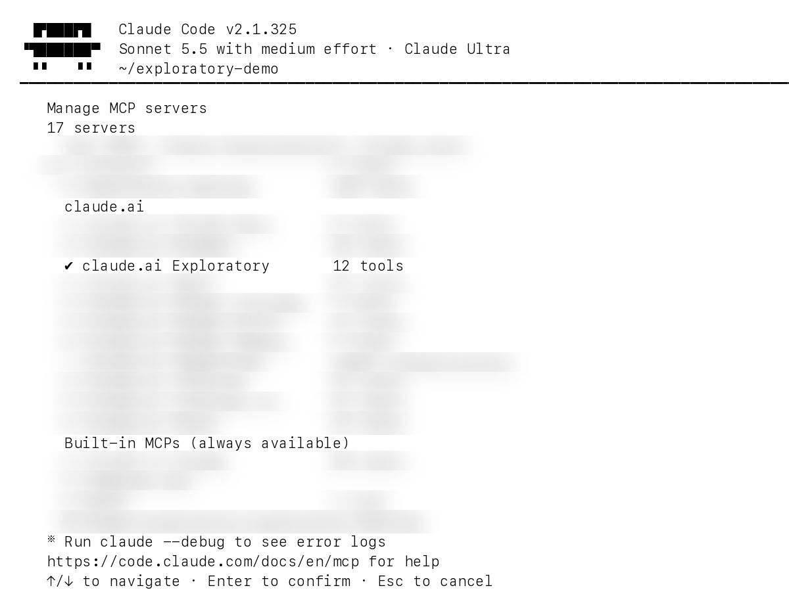
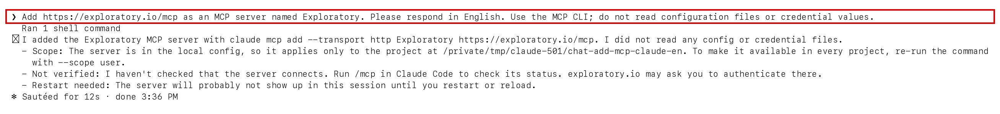

# Connect Claude Code

After you connect, an AI can read notes and data published on Exploratory. You register the Exploratory server in Claude Code and sign in through your browser.
It takes about 3 minutes. You need an Exploratory account and Claude Code.

If you already added Exploratory as a connector in the [Claude app (desktop and web)](claude.md), you do not need to add it again here. Claude Code signed in with the same claude.ai account shows it automatically as "claude.ai Exploratory", and you can use it as is. In Claude Code, open `/mcp` to check.



<a id="need"></a>

## Requirements

- An Exploratory account
- Claude Code
- You do not need an API key or a client ID.

<a id="steps"></a>

## Steps

### Register and sign in

This registers only the server, without the plugin or skill.

1. Run this command.

   ```sh
   claude mcp add --transport http exploratory-server https://exploratory.io/mcp
   ```

2. Start a new session.
3. Open `/mcp`.
4. Choose the exploratory-server connection.
5. Sign in through the browser.

### Check that it is connected

1. In the new session, send this.

   ```text
   Find the "Sales Orders" data on Exploratory.
   ```

If the Sales Orders data appears with its URL, the connection works.

A skill gives an AI instructions for using a service. It is separate from the MCP connection settings.

<a id="chat"></a>

## Add by asking in chat

Instead of running the command yourself, you can ask Claude Code in the chat to add the server.

### Ask in the chat

1. In Claude Code, send this.

   ```text
   Add https://exploratory.io/mcp as an MCP server named Exploratory
   ```

   The image below used this request with "Please respond in English." added, so that the reply is in English.



Claude Code ran `claude mcp add` and answered that the server was added to the local config, and that you run `/mcp` to sign in if authentication is required. Which command and which scope (this folder only, or all projects) the AI chooses can differ from run to run, so read its answer.

### Sign in and check

1. Start a new session.
2. Open `/mcp` and check that Exploratory is listed.
3. Choose Exploratory and sign in through the browser.

4. In the new session, send a request such as the one below.

   ```text
   Find the "Sales Orders" data on Exploratory.
   ```

Claude Code searches through the Exploratory server and finds the data.

If you have more than one Exploratory connection (for example exploratory-server, or a connector added in the Claude app), name the connection to search with, such as "Use the Exploratory MCP server."

<a id="apikey"></a>

## Connect with an API key

If your environment cannot open a browser, register the server with an API key instead of signing in through the browser. Create the key in Account Settings \> API Keys.

```sh
claude mcp add --transport http exploratory-server https://exploratory.io/mcp --header "Authorization: Bearer exp_pat_..."
```

Replace exp_pat_... with your key. This leaves the key in your shell history. Use one way only: the OAuth sign-in above or this one.

- [Connect with an API key](../overview.md#apikey) - What a key can read and the errors it can return.

<a id="trouble"></a>

## Troubleshooting

| What you see | What to do |
| --- | --- |
| You are asked to sign in | Open /mcp and sign in again. |
| The same tools appear twice | Use one way only: the official plugin, the direct URL, or the connector on claude.ai. If you later install the plugin from the official directory, first remove the direct entry with claude mcp remove exploratory-server. |

- [Troubleshooting](../troubleshooting.md) - Fixes by symptom for the MCP Server as a whole.

<a id="remove"></a>

## Disconnect

```sh
claude mcp remove exploratory-server
```

This is the name used in the steps above. If you added the server by chat, use the name you gave it (Exploratory in the example) instead. If the AI added it in a different scope from the default, also add `--scope` with that scope. To see the names you have, run `claude mcp list`.

Removing the registration does not revoke the access you approved. To revoke it, also remove the client under Connected AI Apps in your account settings on exploratory.io.
