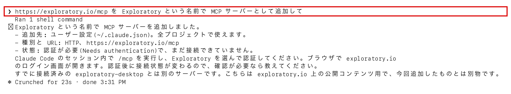
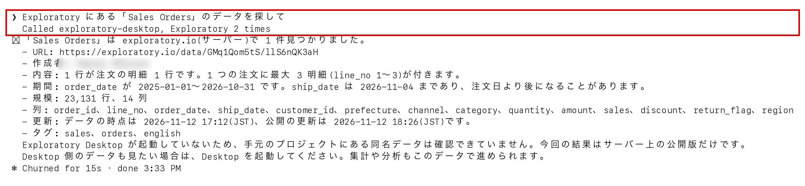

# Claude Code につなぐ

接続すると、AI から Exploratory に公開されたノートやデータを読めるようになります。Claude Code に Exploratory のサーバーを登録し、ブラウザでサインインします。
かかる時間は 3 分ほどです。Exploratory のアカウントと、Claude Code を用意してください。

<a id="need"></a>

## 必要なもの

- Exploratory のアカウント
- Claude Code
- API キーとクライアント ID は必要ありません。

<a id="steps"></a>

## 手順

### 登録してサインインする

プラグインやスキルを使わずに、サーバーだけを登録する方法です。

1. 次のコマンドを実行します。

   ```sh
   claude mcp add --transport http exploratory-server https://exploratory.io/mcp
   ```

2. 新しいセッションを開始します。
3. `/mcp` を開きます。
4. exploratory-server の接続を選びます。
5. ブラウザでサインインします。

### つながったことを確かめる

1. 新しいセッションで、次のように送信します。

   ```text
   Exploratory にある「Sales Orders」のデータを探して
   ```

Sales Orders のデータが URL 付きで表示されていれば、接続できています。

スキルは、AI に操作の進め方を教える説明です。MCP の接続設定とは別のものです。

<a id="chat"></a>

## チャットで頼んで追加する

コマンドを自分で実行する代わりに、Claude Code のチャットで頼んで、サーバーを追加してもらうこともできます。

### チャットで頼む

1. Claude Code で、次の文を送ります。

   ```text
   https://exploratory.io/mcp を Exploratory という名前で MCP サーバーとして追加して
   ```



Claude Code は `claude mcp add` を実行し、サーバーを追加したこと、まだ認証が必要で接続できていないことを答えました。AI がどのコマンドを選ぶか、どの範囲（このフォルダだけか、全プロジェクトか）に保存するかは、実行のたびに変わることがあります。返答を読んで確かめてください。

### サインインして確かめる

1. 新しいセッションを始めます。
2. `/mcp` を開き、Exploratory が一覧にあることを確かめます。

3. Exploratory を選び、ブラウザでサインインします。
4. 新しいセッションで、次のような依頼を送ります。

   ```text
   Exploratory にある「Sales Orders」のデータを探して
   ```



Exploratory への接続が複数あるとき（たとえば exploratory-server や、Claude アプリで追加したコネクタ）は、「Exploratory の MCP サーバーを使って」のように、検索に使う接続名を指定します。

<a id="apikey"></a>

## API キーで接続する

ブラウザを開けない環境では、ブラウザでのサインインの代わりに、API キーでサーバーを登録します。キーは、アカウント設定 \> API キーで作ります。

```sh
claude mcp add --transport http exploratory-server https://exploratory.io/mcp --header "Authorization: Bearer exp_pat_..."
```

exp_pat_... は、作成したキーに置き換えます。キーがシェルの履歴に残ります。上の OAuth でのサインインか、この方法か、どちらか一方だけを使います。

- [API キーで接続する](../overview_ja.md#apikey) - キーで読めるものと、返ってくるエラーです。

<a id="trouble"></a>

## トラブルシューティング

| 表示される内容 | 対処 |
| --- | --- |
| サインインを求められる | /mcp を開いて、もう一度サインインします。 |
| 同じツールが 2 組表示される | インストール方法は 1 つだけにします（公式のプラグイン、URL の直接追加、claude.ai のコネクタのいずれか）。あとから公式の一覧でインストールする場合は、先に直接追加した分を claude mcp remove exploratory-server で削除します。 |

- [トラブルシューティング](../troubleshooting_ja.md) - MCP Server 全体の、症状ごとの対処です。

<a id="remove"></a>

## 接続を解除する

```sh
claude mcp remove exploratory-server
```

登録を解除しても、アクセスの許可は残ります。許可も取り消すには、exploratory.io のアカウント設定の「接続中のAIアプリ」から、クライアントを解除します。
