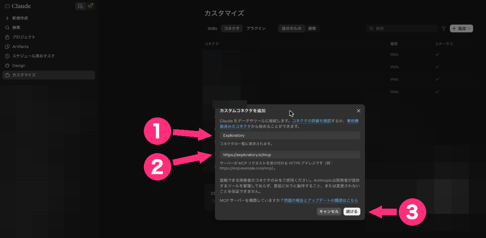

# Connect the Claude app (desktop and web)

Add the Exploratory server to Claude as a custom connector. A connector is a link that lets Claude use the data and features of an outside service. After you add it, sign in to Exploratory and approve the access, and you can read notes and data published on Exploratory from a Claude chat.

The connector screens are the same in the Claude desktop app and on the web (claude.ai). The screenshots on this page show the Japanese screen.

<a id="need"></a>

## Requirements

- An Exploratory account
- The Claude desktop app, or the web version (claude.ai)

You do not need an API key or a client ID.

<a id="steps"></a>

## Steps

### 1. Open the connectors screen

In Claude, open settings, then open Connectors under Customize. The list of your own connectors opens.


In the image, 1 is Customize, 2 is the connectors tab and 3 is the add button.

### 2. Open the screen for adding a custom connector

Use the add button in the connectors list and choose the option to add a custom connector.


In the image, 1 is the option to add a custom connector.

### 3. Enter the name and the URL

In the name field, enter the name to show in the list, for example Exploratory.

In the MCP server URL field, enter this URL.

```text
https://exploratory.io/mcp
```

When both are filled in, continue to the next screen.



In the image, 1 is the name, 2 is the MCP server URL and 3 is the button to continue.

### 4. Keep the authentication settings and add the connector

The second screen shows the authentication settings. Leave them as they are: the sign-in option that is detected, and Claude's public identity as the OAuth client. Both are marked as detected.

Add the connector.


In the image, 1 is the sign-in option that is detected and 2 is the button to add the connector.

### 5. Approve the access

Your browser opens exploratory.io and shows "Claude is asking for access to your Exploratory account". If you are not signed in, sign in first. Choose Allow.


In the image, 1 is Allow.

### 6. Check that it is connected

When Exploratory appears in the connectors list as a custom connector with a check mark that shows it is connected, the connection works.


In the image, 1 is the Exploratory row that was added to the list.

### 7. Try it

Open a new chat and send this.

```text
Find the "Sales Orders" data on Exploratory.
```

If the Sales Orders data appears with its URL, it works.

<a id="permissions"></a>

## Check when tools run

Open Exploratory in the list to see the server URL (https://exploratory.io/mcp) and the tool permissions. The tools of the Exploratory connector are grouped as read-only tools. You can choose when each tool runs. This setting decides when Claude may use the tools in Manual mode. In Auto mode, an automated check blocks actions it flags as risky; for other actions, Claude may act without asking, even for tools set to Needs approval.


In the image, 1 is the server URL and 2 is the tool permissions.

<a id="trouble"></a>

## If it does not work

| What you see | What to do |
| --- | --- |
| A message says that a connector for this URL already exists in your organization | Someone on your team (organization) already added it. Do not add it again; use the existing connector in the list. |
| You are asked to sign in | Open Exploratory in the connectors list and sign in again. |

For other symptoms, see [Troubleshooting](../troubleshooting.md).

<a id="remove"></a>

## Disconnect

Open Exploratory in the connectors list and use the disconnect button at the top right.

Disconnecting does not revoke the access you approved on Exploratory. To revoke it too, open Account Settings on exploratory.io and remove Claude under Connected AI Apps.
