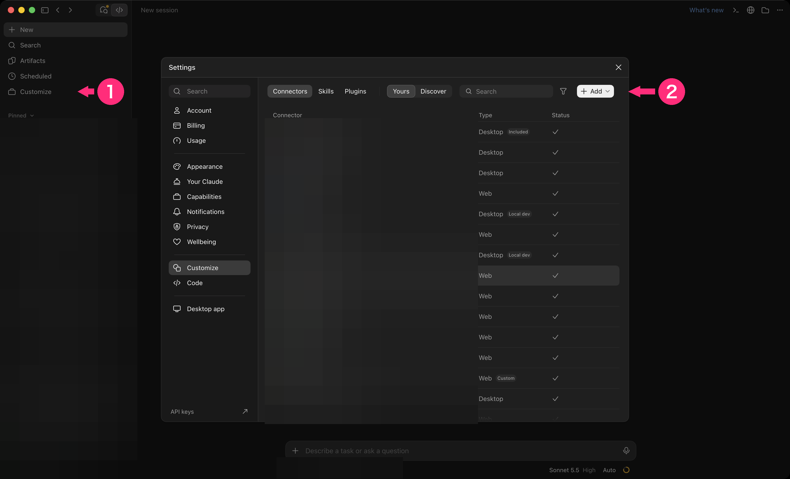
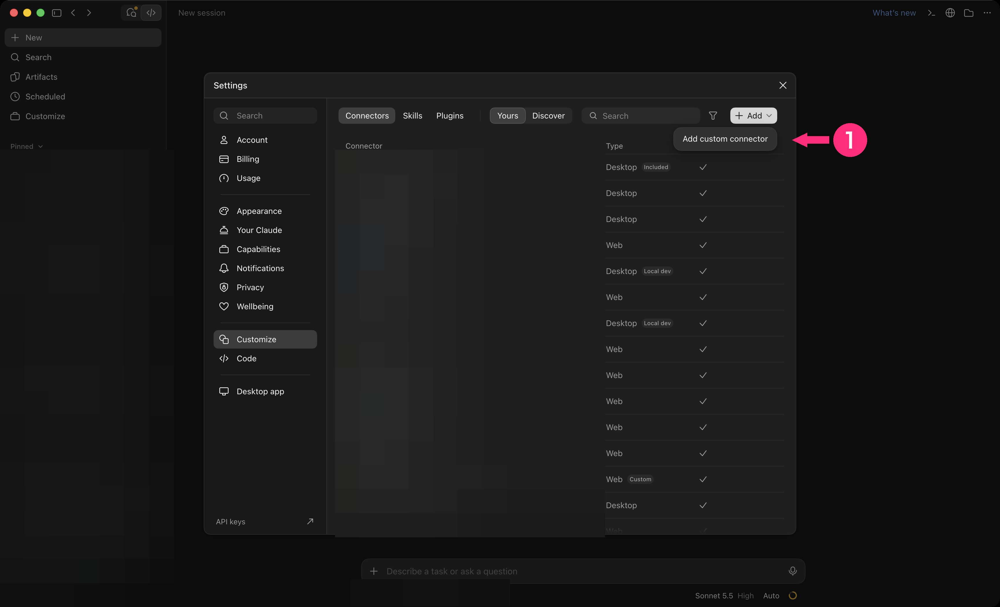
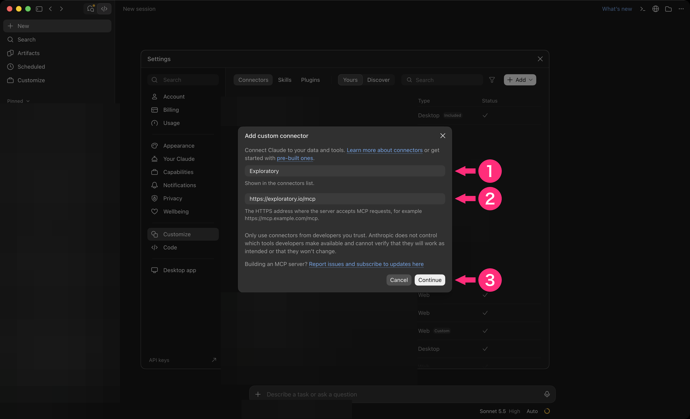
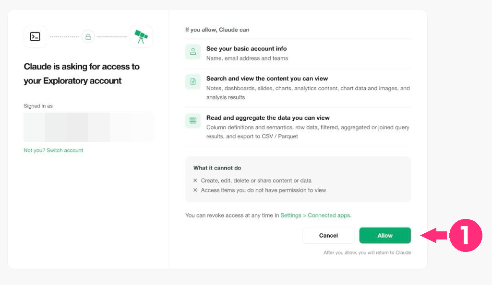

# Connect the Claude app (desktop and web)

Add the Exploratory server to Claude as a custom connector. A connector is a link that lets Claude use the data and features of an outside service. After you add it, sign in to Exploratory and approve the access, and you can read notes and data published on Exploratory from a Claude chat.

The connector screens are the same in the Claude desktop app and on the web (claude.ai). It takes about 5 minutes.

<a id="need"></a>

## Requirements

- An Exploratory account
- The Claude desktop app, or the web version (claude.ai)

You do not need an API key or a client ID.

<a id="steps"></a>

## Steps

### Open the add screen

In the Claude desktop app, open the Connectors screen in Settings.

1. Choose Customize in the sidebar on the left. Settings opens and shows the Connectors screen.
2. Check that Yours is selected, then choose Add in the list.



Next, open the add menu.

1. Choose Add custom connector.



### Enter the address

1. In the name field, enter the name to show in the list, for example Exploratory.
2. In the MCP server URL field, enter this URL.

   ```text
   https://exploratory.io/mcp
   ```

3. Choose Continue.



### Check the authentication and add

1. Check that Authentication is Sign in now and that OAuth client is Use Claude's published identity. Both are marked Detected. There is nothing to change.
2. Choose Add.


### Approve the access on exploratory.io

Your browser opens exploratory.io and shows "Claude is asking for access to your Exploratory account". If you are not signed in, sign in first.

1. Choose Allow.



If the connector connects without showing this screen, go on to the next check.

### Check that it is connected

1. When Exploratory appears in the Yours list with the Custom label and a check mark under Status, the connection works.


Open a new chat and send this.

```text
Find the "Sales Orders" data on Exploratory.
```

If the Sales Orders data appears with its URL, it works.

<a id="permissions"></a>

## Check when tools run

Open Exploratory in the list to see these two items.

1. The server URL (https://exploratory.io/mcp)
2. Tool permissions


The tools of the Exploratory connector are grouped under Read-only tools. You can choose when each tool runs. This setting decides when Claude may use the tools in Manual mode. In Auto mode, an automated check blocks actions it flags as risky; for other actions, Claude may act without asking, even for tools set to Needs approval.

<a id="trouble"></a>

## If it does not work

| What you see | What to do |
| --- | --- |
| A message says that a connector for this URL already exists in your organization | Someone on your team (organization) already added it. Do not add it again; use the existing connector in the list. |
| You are asked to sign in | Open Exploratory in the connectors list and sign in again. |

For other symptoms, see [Troubleshooting](../troubleshooting.md).

<a id="remove"></a>

## Disconnect

Open Exploratory in the connectors list and use the disconnect button at the top right.

Disconnecting does not revoke the access you approved on Exploratory. To revoke it too, open Account Settings on exploratory.io and remove Claude under Connected AI Apps.
