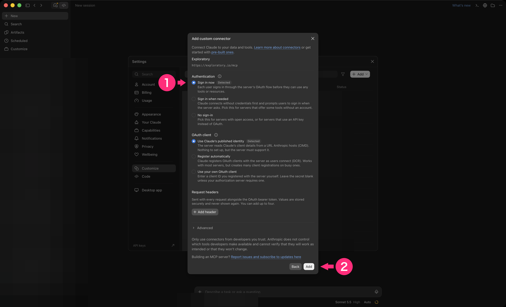
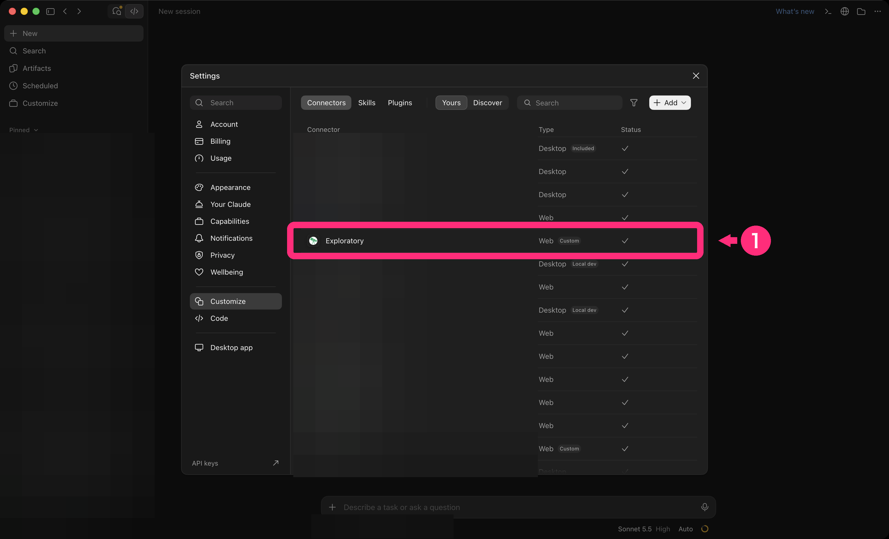
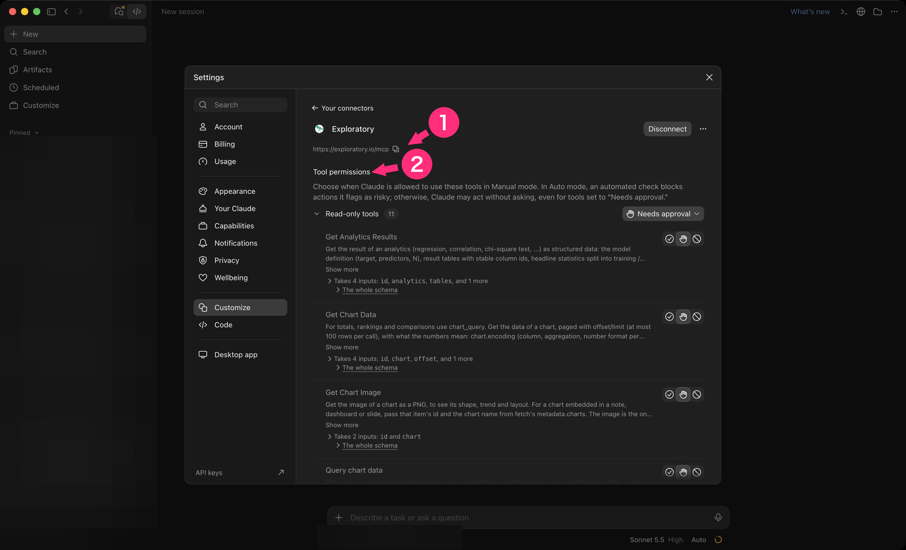

# Connect the Claude app (desktop and web)

Add the Exploratory server to Claude as a custom connector. A connector is a link that lets Claude use the data and features of an outside service. After you add it, sign in to Exploratory and approve the access, and you can read notes and data published on Exploratory from a Claude chat.

The connector screens are the same in the Claude desktop app and on the web (claude.ai). 

<a id="need"></a>

## Requirements

- An Exploratory account
- The Claude desktop app, or the web version (claude.ai)

You do not need an API key or a client ID.

<a id="steps"></a>

## Steps

### 1. Choose Customize

In the Claude desktop app, choose Customize in the sidebar on the left. Settings opens.

### 2. Check the Connectors tab

In Settings, check that the Connectors tab is selected and that Yours is selected. The connectors you have added are listed.


In the image, 1 is Customize in step 1 and 2 is Add in step 3.

### 3. Choose Add

Choose Add at the top right of the list.

### 4. Choose Add custom connector

In the menu, choose Add custom connector.


In the image, 1 is Add custom connector.

### 5. Enter the name

On the Add custom connector screen, enter the name to show in the list, for example Exploratory, in the name field.

### 6. Enter the URL

In the MCP server URL field, enter this URL.

```text
https://exploratory.io/mcp
```

### 7. Continue

Choose Continue.


In the image, 1 is the name, 2 is the MCP server URL and 3 is Continue.

### 8. Check the authentication settings

The second screen shows the authentication settings. Leave them as they are: Sign in now under Authentication, and Use Claude's published identity under OAuth client. Both are marked Detected.

### 9. Add the connector

Choose Add.



In the image, 1 is Sign in now (step 8) and 2 is Add (step 9).

### 10. Approve the access

If your browser opens exploratory.io and shows "Claude is asking for access to your Exploratory account", choose Allow. If you are not signed in, sign in first. If the connector connects without showing this screen, go on to the next step.


In the image, 1 is Allow.

### 11. Check that it is connected

When Exploratory appears in the list with the Custom label and a check mark under Status, the connection works.



In the image, 1 is the Exploratory row that was added to the list.

### 12. Try it

Open a new chat and send this.

```text
Find the "Sales Orders" data on Exploratory.
```

If the Sales Orders data appears with its URL, it works.

<a id="permissions"></a>

## Check when tools run

Open Exploratory in the list to see the server URL (https://exploratory.io/mcp) and Tool permissions. The tools of the Exploratory connector are grouped under Read-only tools. You can choose when each tool runs. This setting decides when Claude may use the tools in Manual mode. In Auto mode, an automated check blocks actions it flags as risky; for other actions, Claude may act without asking, even for tools set to Needs approval.



In the image, 1 is the server URL and 2 is the Tool permissions heading.

<a id="trouble"></a>

## If it does not work

| What you see | What to do |
| --- | --- |
| A message says that a connector for this URL already exists in your organization | Someone on your team (organization) already added it. Do not add it again; use the existing connector in the list. |
| You are asked to sign in | Open Exploratory in the connectors list and sign in again. |

For other symptoms, see [Troubleshooting](../troubleshooting.md).

<a id="remove"></a>

## Disconnect

Open Exploratory in the connectors list and use the disconnect button at the top right.

Disconnecting does not revoke the access you approved on Exploratory. To revoke it too, open Account Settings on exploratory.io and remove Claude under Connected AI Apps.
