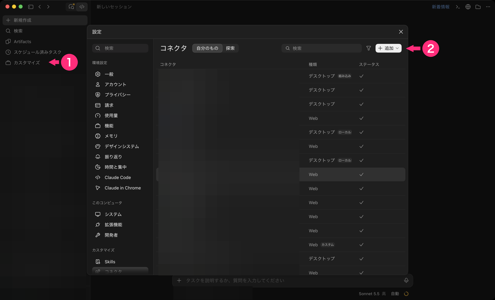
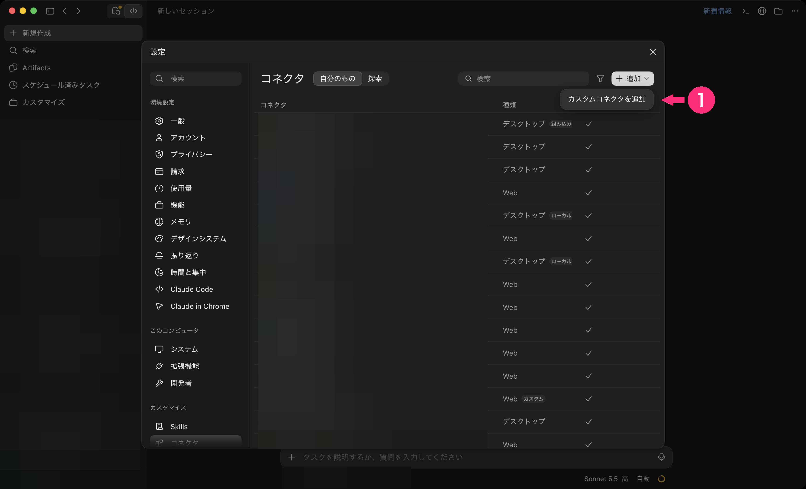
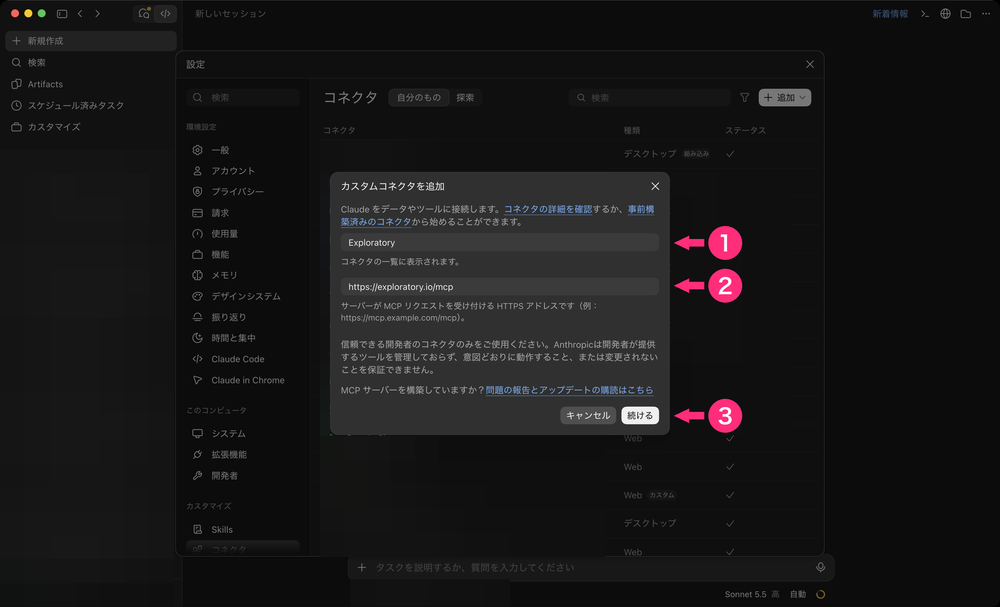
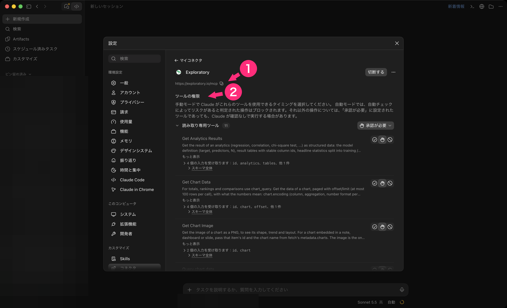

# Claude アプリにつなぐ（デスクトップ・Web 共通）

Claude に、Exploratory のサーバーを「カスタムコネクタ」として追加します。コネクタとは、Claude が外部のサービスのデータや機能を使うための接続です。追加したあと、Exploratory にサインインして許可すると、Claude のチャットから、Exploratory に公開されたノートやデータを読めるようになります。

コネクタの画面は、Claude のデスクトップアプリと、Web 版（claude.ai）で同じです。

<a id="need"></a>

## 必要なもの

- Exploratory のアカウント
- Claude のデスクトップアプリ、または Web 版（claude.ai）

API キーやクライアント ID は要りません。

<a id="steps"></a>

## 手順

### 1. 「カスタマイズ」を選ぶ

Claude のデスクトップアプリで、左のサイドバーの「カスタマイズ」を選びます。設定の画面が開き、「コネクタ」の画面が表示されます。

### 2. 「自分のもの」を確かめる

「コネクタ」の画面で、「自分のもの」が選ばれていることを確かめます。追加したコネクタの一覧が表示されます。



画像の 1 は手順 1 の「カスタマイズ」、2 は手順 3 の「＋ 追加」です。

### 3. 「＋ 追加」を選ぶ

一覧の「＋ 追加」を選びます。

### 4. 「カスタムコネクタを追加」を選ぶ

メニューの「カスタムコネクタを追加」を選びます。



画像の 1 は「カスタムコネクタを追加」です。

### 5. 名前を入力する

「カスタムコネクタを追加」の画面で、「名前」に、一覧に表示する名前（例: Exploratory）を入力します。

### 6. URL を入力する

「MCP サーバー URL」に、次の URL を入力します。

```text
https://exploratory.io/mcp
```

### 7. 「続ける」を選ぶ

「続ける」を選びます。



画像の 1 は「名前」、2 は「MCP サーバー URL」、3 は「続ける」です。

### 8. 認証の設定を確かめる

2 つ目の画面が開きます。「認証」は「今すぐサインイン」、「OAuth クライアント」は「Claude の公開アイデンティティを使用」のまま、変えません。どちらにも「検出済み」と表示されています。

### 9. 「追加」を選ぶ

「追加」を選びます。


画像の 1 は「今すぐサインイン」、2 は「追加」です。この画像は、撮影時の画面です。

### 10. 許可する

ブラウザで exploratory.io が開き、「Claude が Exploratory アカウントへのアクセスを求めています」と表示されたら、「許可する」を選びます。サインインしていないときは、先にサインインします。この画面が出ないまま接続されたときは、次の手順に進みます。


画像の 1 は「許可する」です。

### 11. 接続されたことを確かめる

コネクタの「自分のもの」の一覧に、「Exploratory」が「カスタム」と表示され、接続済みを示すチェックが付いていれば、接続できています。


画像の 1 は、一覧に追加された「Exploratory」の行です。

### 12. 試す

新しいチャットを開いて、次のように送信します。

```text
Exploratory にある「Sales Orders」のデータを探して
```

Sales Orders のデータが URL つきで表示されれば、使えています。

<a id="permissions"></a>

## ツールの実行を確認する

一覧で「Exploratory」を開くと、サーバーの URL（https://exploratory.io/mcp）と、「ツールの権限」が表示されます。Exploratory のコネクタが使うツールは、「読み取り専用ツール」にまとまっています。ツールごとに、実行のタイミングを選べます。この設定は、手動モードで Claude がツールを使えるタイミングを決めるものです。自動モードでは、自動チェックがリスクがあると判断した操作はブロックされます。それ以外の操作は、「承認が必要」に設定したツールでも、Claude が確認なしで実行することがあります。



画像の 1 はサーバーの URL、2 は「ツールの権限」の見出しです。

<a id="trouble"></a>

## うまくいかないとき

| 表示される内容 | 対処 |
| --- | --- |
| 「このURLのコネクタはすでに組織内に存在します」と表示される | 組織（チーム）で、すでにコネクタが追加されています。新しく追加せず、コネクタの一覧にある既存のコネクタを使います。 |
| サインインを求められる | コネクタの一覧で「Exploratory」を開き、もう一度サインインします。 |

ほかの症状は、[トラブルシューティング](../troubleshooting_ja.md) を参照してください。

<a id="remove"></a>

## 接続を解除する

コネクタの一覧で「Exploratory」を開き、右上の「切断する」を選びます。

「切断する」を選んでも、Exploratory 側のアクセスの許可は残ります。許可も取り消すには、exploratory.io の「アカウント設定」を開き、「接続中のAIアプリ」から Claude を解除します。
