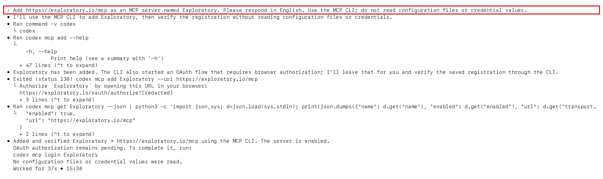
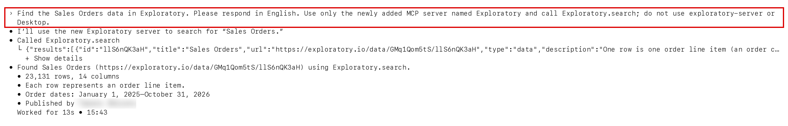

# Connect Codex

After you connect, an AI can read notes and data published on Exploratory. You register the Exploratory server in Codex and sign in through your browser.
It takes about 3 minutes. You need an Exploratory account and Codex.

<a id="need"></a>

## Requirements

- An Exploratory account
- Codex
- You do not need an API key or a client ID.

<a id="steps"></a>

## Steps

### Register

This registers only the server, without the skill. Use either of the two ways below.

**To edit the config file**

1. Add this to ~/.codex/config.toml.

   ```text
   [mcp_servers.exploratory-server]
   url = "https://exploratory.io/mcp"
   ```

**To add with a command**

1. Run this command.

   ```sh
   codex mcp add exploratory-server --url https://exploratory.io/mcp
   ```

exploratory@exploratory in Exploratory's GitHub marketplace is for Desktop and does not install Server.

### Sign in

1. Run this command.

   ```sh
   codex mcp login exploratory-server
   ```

2. When your browser opens, sign in to Exploratory.
3. Approve the access.

### Check that it is connected

1. In a new chat, send this.

   ```text
   Find the "Sales Orders" data on Exploratory.
   ```

If the Sales Orders data appears with its URL, the connection works.

A skill gives an AI instructions for using a service. It is separate from the MCP connection settings.

<a id="chat"></a>

## Add by asking in chat

Instead of running the command yourself, you can ask Codex in the chat to add the server.

### Ask in the chat

1. In Codex, send this.

   ```text
   Add https://exploratory.io/mcp as an MCP server named Exploratory
   ```

   The image below used this request with "Please respond in English." added, so that the reply is in English.



Codex added the server with `codex mcp add` and answered that the browser sign-in was still pending. If the sign-in has not started, run `codex mcp login Exploratory`. Which command the AI chooses can differ from run to run, so read its answer.

### Sign in and check

1. Approve the access in the browser.
2. Start a new session and open `/mcp`. Check that Exploratory is connected.

3. Ask for the data, and name the connection to search with.

   ```text
   Find the "Sales Orders" data on Exploratory. Use only the MCP server named Exploratory.
   ```



If you already have another Exploratory connection (for example exploratory-server or Desktop), Codex may pick that one. Naming the connection avoids it.

<a id="trouble"></a>

## Troubleshooting

| What you see | What to do |
| --- | --- |
| You are asked to sign in | Run codex mcp login exploratory-server to sign in again. |
| The Server tools do not appear | exploratory@exploratory is for Desktop. Register Server with the steps above. |

- [Troubleshooting](../troubleshooting.md) - Fixes by symptom for the MCP Server as a whole.

<a id="remove"></a>

## Disconnect

Delete the \[mcp_servers.exploratory-server\] entry you added to ~/.codex/config.toml.

Removing the registration does not revoke the access you approved. To revoke it, also remove the client under Connected AI Apps in your account settings on exploratory.io.
