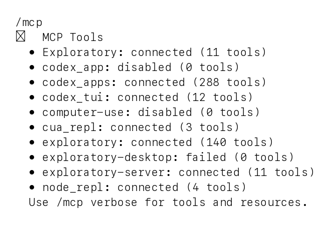
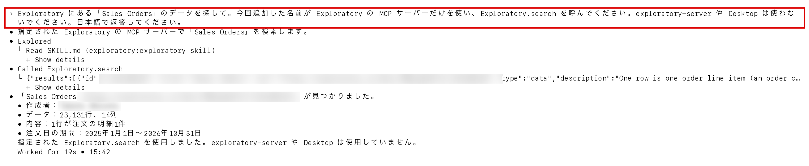

# Codex につなぐ

接続すると、AI から Exploratory に公開されたノートやデータを読めるようになります。Codex に Exploratory のサーバーを登録し、ブラウザでサインインします。
かかる時間は 3 分ほどです。Exploratory のアカウントと、Codex を用意してください。

<a id="need"></a>

## 必要なもの

- Exploratory のアカウント
- Codex
- API キーとクライアント ID は必要ありません。

<a id="steps"></a>

## 手順

### 登録する

サーバーのみを登録します。スキルは含まれません。次のいずれかの方法で登録します。

**設定ファイルに書く場合**

1. ~/.codex/config.toml に、次の内容を追加します。

   ```text
   [mcp_servers.exploratory-server]
   url = "https://exploratory.io/mcp"
   ```

**コマンドで追加する場合**

1. 次のコマンドを実行します。

   ```sh
   codex mcp add exploratory-server --url https://exploratory.io/mcp
   ```

Exploratory の GitHub マーケットプレイスの exploratory@exploratory は Desktop 用で、Server は含まれません。

### サインインする

1. 次のコマンドを実行します。

   ```sh
   codex mcp login exploratory-server
   ```

2. ブラウザが開いたら、Exploratory にサインインします。
3. アクセスを許可します。

### つながったことを確かめる

1. 新しいチャットで、次のように送信します。

   ```text
   Exploratory にある「Sales Orders」のデータを探して
   ```

Sales Orders のデータが URL 付きで表示されていれば、接続できています。

スキルは、AI に操作の進め方を教える説明です。MCP の接続設定とは別のものです。

<a id="chat"></a>

## チャットで頼んで追加する

コマンドを自分で実行する代わりに、Codex のチャットで頼んで、サーバーを追加してもらうこともできます。

### チャットで頼む

1. Codex で、次の文を送ります。

   ```text
   https://exploratory.io/mcp を Exploratory という名前で MCP サーバーとして追加して
   ```

Codex は、サーバーを追加し、ブラウザでの認証が必要であることを答えます。認証が始まっていないときは、`codex mcp login Exploratory` を実行します。AI がどのコマンドを選ぶかは、実行のたびに変わることがあります。返答を読んで確かめてください。

### サインインして確かめる

1. ブラウザでアクセスを許可します。
2. 新しいセッションを始めて、`/mcp` を開きます。Exploratory が connected になっていることを確かめます。



3. データを探すときは、検索に使う接続名を指定します。

   ```text
   Exploratory にある「Sales Orders」のデータを探して。名前が Exploratory の MCP サーバーだけを使ってください。
   ```



すでに Exploratory への別の接続（たとえば exploratory-server や Desktop）があると、Codex がそちらを選ぶことがあります。接続名を指定すると、それを避けられます。

<a id="trouble"></a>

## トラブルシューティング

| 表示される内容 | 対処 |
| --- | --- |
| サインインを求められる | codex mcp login exploratory-server を実行して、もう一度サインインします。 |
| Server のツールが出ない | exploratory@exploratory は Desktop 用です。上の手順で、Server を登録します。 |

- [トラブルシューティング](../troubleshooting_ja.md) - MCP Server 全体の、症状ごとの対処です。

<a id="remove"></a>

## 接続を解除する

~/.codex/config.toml に追加した \[mcp_servers.exploratory-server\] の部分を削除します。

登録を解除しても、アクセスの許可は残ります。許可も取り消すには、exploratory.io のアカウント設定の「接続中のAIアプリ」から、クライアントを解除します。
