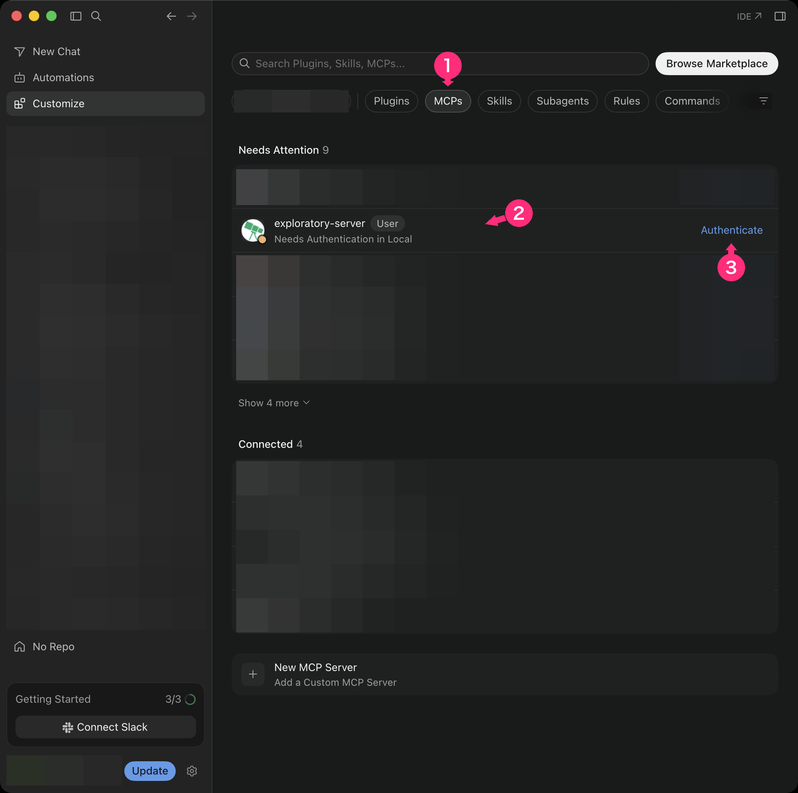
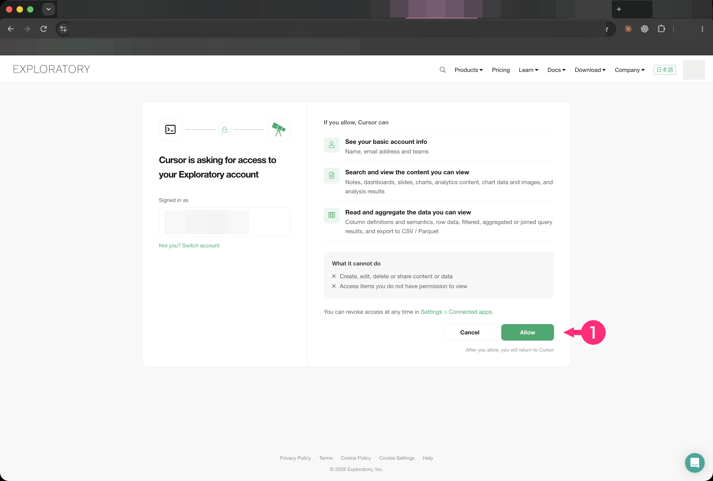
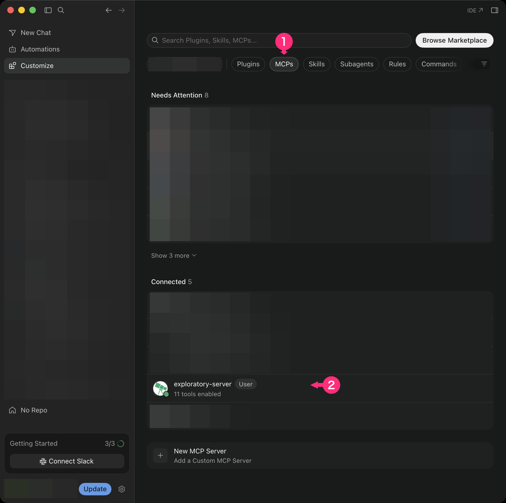
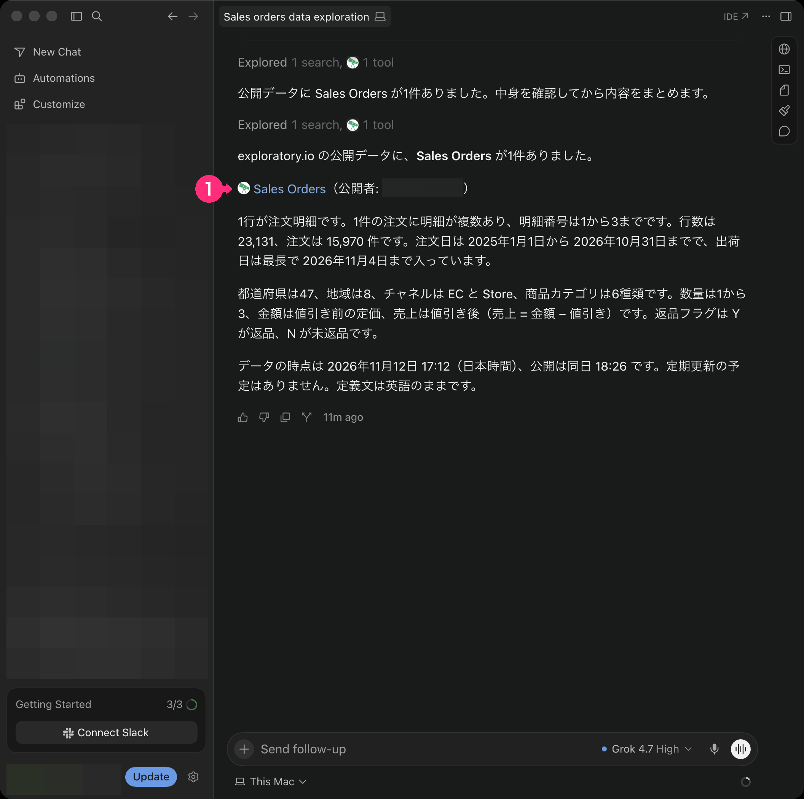

# Connect Cursor

After you connect, an AI can read notes and data published on Exploratory. You register the Exploratory server in the Cursor agent and sign in through your browser. It works with the model you pick in Cursor, including Grok.
It takes about 5 minutes. You need an Exploratory account and Cursor.

<a id="need"></a>

## Requirements

- An Exploratory account
- Cursor (the agent is agent or cursor-agent)
- You do not need an API key or a client ID.

<a id="steps"></a>

## Steps

### Register in mcp.json

Until Exploratory Server is listed in the official plugin directory, add only the server by hand, without the skill.

1. Open ~/.cursor/mcp.json (or .cursor/mcp.json in a project).
2. Add this.

   ```text
   {
     "mcpServers": {
       "exploratory-server": {
         "type": "http",
         "url": "https://exploratory.io/mcp"
       }
     }
   }
   ```

### Open MCPs and sign in

In the Cursor app, choose Customize in the sidebar to check the MCP server you added.

1. Choose MCPs.
2. Check the exploratory-server row. Before you sign in, it shows "Needs Authentication in Local".
3. Choose Authenticate at the right of the row.



Instead of the app, you can start the sign-in in a terminal.

```sh
agent mcp login exploratory-server
```

Next, your browser opens. If you are not signed in, sign in to Exploratory. Choosing Authenticate in the app and running the terminal command open the same browser screen.

1. Choose Allow.



### Check that it is connected

When you have signed in, exploratory-server moves to the Connected list under MCPs.

1. Choose MCPs.
2. Check the exploratory-server row in the Connected list.



### Try it

1. In a new chat, send this.

   ```text
   Find the "Sales Orders" data on Exploratory.
   ```

Next, check the result.

1. Check the Sales Orders link in the search result.



If the Sales Orders data appears with its URL, the connection works.

A skill gives an AI instructions for using a service. It is separate from the MCP connection settings.

<a id="trouble"></a>

## Troubleshooting

| What you see | What to do |
| --- | --- |
| You are asked to sign in | Run agent mcp login exploratory-server to sign in again. |
| You installed the Desktop plugin but the Server tools do not appear | The Desktop plugin does not add Server. Add Server with the JSON above. |

- [Troubleshooting](../troubleshooting.md) - Fixes by symptom for the MCP Server as a whole.

<a id="remove"></a>

## Disconnect

Delete the exploratory-server entry you added to mcp.json.

Removing the registration does not revoke the access you approved. To revoke it, also remove the client under Connected AI Apps in your account settings on exploratory.io.
