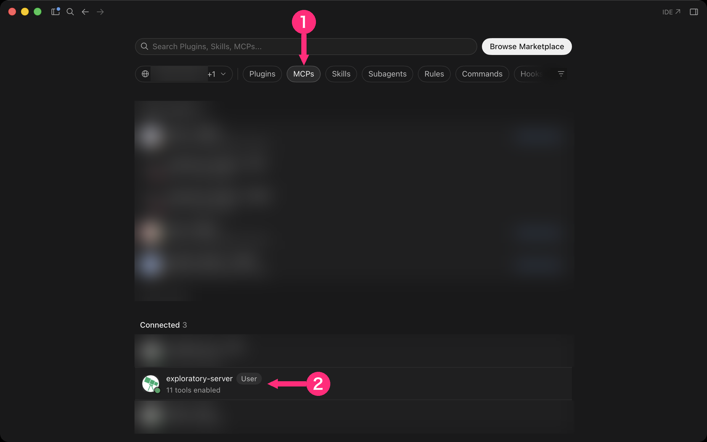
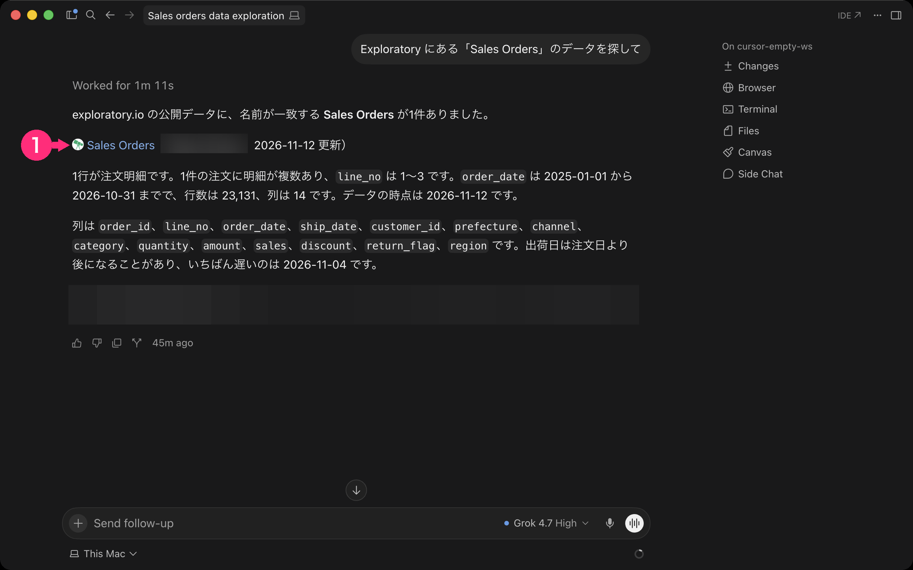

# Cursor につなぐ

接続すると、AI から Exploratory に公開されたノートやデータを読めるようになります。Cursor のエージェントに Exploratory のサーバーを登録し、ブラウザでサインインします。Grok を含め、Cursor で選んだモデルで使えます。
かかる時間は 5 分ほどです。Exploratory のアカウントと、Cursor を用意してください。

<a id="need"></a>

## 必要なもの

- Exploratory のアカウント
- Cursor（エージェントは agent か cursor-agent）
- API キーとクライアント ID は必要ありません。

<a id="steps"></a>

## 手順

### mcp.json に登録する

Exploratory Server は公式のプラグイン一覧にありません。サーバーのみを手動で追加します。スキルは含まれません。

1. ~/.cursor/mcp.json（プロジェクト単位の場合は .cursor/mcp.json）を開きます。
2. 次の内容を記述します。

   ```text
   {
     "mcpServers": {
       "exploratory-server": {
         "type": "http",
         "url": "https://exploratory.io/mcp"
       }
     }
   }
   ```

### 「MCPs」を開く

Cursor のアプリで、追加した MCP サーバーを確かめます。

1. サイドバーの「Customize」を選びます。

続けて、「Customize」の画面で操作します。

1. 「MCPs」を選びます。
2. exploratory-server の行を確かめます。サインインの前は、「Needs Authentication in Local」と表示されます。
3. 行の右の「Authenticate」を選びます。


アプリの代わりに、ターミナルでサインインを始めることもできます。

```sh
agent mcp login exploratory-server
```

### exploratory.io で許可する

ブラウザが開きます。サインインしていないときは、Exploratory にサインインします。アプリの「Authenticate」を選んでも、ターミナルのコマンドでも、同じブラウザの画面が開きます。

1. 「許可する」を選びます。


### つながったことを確かめる

サインインできると、exploratory-server は、「MCPs」の「Connected」の一覧に移ります。

1. 「MCPs」を選びます。
2. 「Connected」の一覧の exploratory-server の行を確かめます。



続けて、新しいチャットで、次のように送信します。

```text
Exploratory にある「Sales Orders」のデータを探して
```

送信したあと、結果を確かめます。

1. 検索結果の「Sales Orders」のリンクを確かめます。



Sales Orders のデータが URL 付きで表示されていれば、接続できています。

スキルは、AI に操作の進め方を教える説明です。MCP の接続設定とは別のものです。

<a id="trouble"></a>

## トラブルシューティング

| 表示される内容 | 対処 |
| --- | --- |
| サインインを求められる | agent mcp login exploratory-server を実行して、もう一度サインインします。 |
| Desktop のプラグインをインストールしたが、Server のツールが表示されない | Desktop のプラグインには、Server は含まれません。上の JSON で、Server を追加します。 |

- [トラブルシューティング](../troubleshooting_ja.md) - MCP Server 全体の、症状ごとの対処です。

<a id="remove"></a>

## 接続を解除する

mcp.json に追加した exploratory-server の部分を削除します。

登録を解除しても、アクセスの許可は残ります。許可も取り消すには、exploratory.io のアカウント設定の「接続中のAIアプリ」から、クライアントを解除します。
