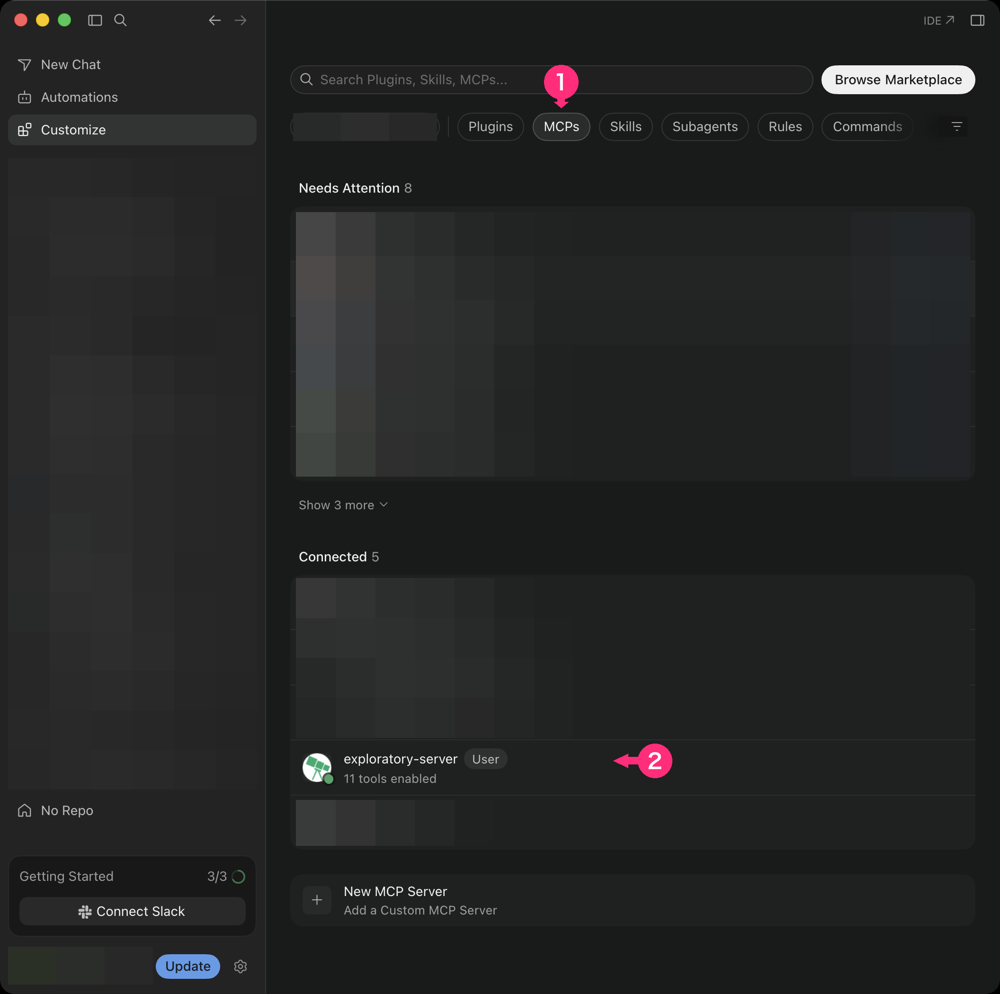

# Cursor につなぐ

Cursor のエージェントに Exploratory のサーバーを登録し、ブラウザでサインインします。Grok を含め、Cursor で選んだモデルで使えます。

<a id="need"></a>

## 必要なもの

- Exploratory のアカウント
- Cursor（エージェントは agent か cursor-agent）
- API キーとクライアント ID は必要ありません。

<a id="steps"></a>

## 手順

### 1. 登録する

Exploratory Server が公式のプラグイン一覧に掲載されるまでは、サーバーのみを手動で追加します。スキルは含まれません。~/.cursor/mcp.json（プロジェクト単位の場合は .cursor/mcp.json）に、次の内容を記述します。

**mcp.json**

```text
{
  "mcpServers": {
    "exploratory-server": {
      "type": "http",
      "url": "https://exploratory.io/mcp"
    }
  }
}
```

Cursor のアプリでは、サイドバーの「Customize」を選び、「MCPs」を選ぶと、追加した MCP サーバーを確かめられます。サインインの前は、exploratory-server の行に「Needs Authentication in Local」と表示され、右に「Authenticate」が表示されます。


画像の 1 は「MCPs」、2 は exploratory-server の行、3 は「Authenticate」です。この画像は、英語の画面です。

### 2. サインインする

```sh
agent mcp login exploratory-server
```

ブラウザが開きます。Exploratory にサインインして、アクセスを許可してください。アプリの「Authenticate」を選んでも、同じブラウザの画面が開きます。


画像の 1 は「許可する」です。

サインインできると、exploratory-server は、「MCPs」の「Connected」の一覧に移ります。



画像の 1 は「MCPs」、2 は「Connected」の一覧の exploratory-server の行です。この画像は、英語の画面です。

### 3. 試す

```text
Exploratory にある「Sales Orders」のデータを探して
```

> Sales Orders のデータが URL 付きで表示されていれば、接続できています。

<!-- image: images/ja/cursor-03-try.png (チャットで確かめる) -->

スキルは、AI に操作の進め方を教える説明です。MCP の接続設定とは別のものです。

<a id="trouble"></a>

## トラブルシューティング

| 表示される内容 | 対処 |
| --- | --- |
| サインインを求められる | agent mcp login exploratory-server を実行して、もう一度サインインします。 |
| Desktop のプラグインをインストールしたが、Server のツールが表示されない | Desktop のプラグインには、Server は含まれません。上の JSON で、Server を追加します。 |

- [トラブルシューティング](../troubleshooting_ja.md) - MCP Server 全体の、症状ごとの対処です。

<a id="remove"></a>

## 接続を解除する

mcp.json に追加した exploratory-server の部分を削除します。

登録を解除しても、アクセスの許可は残ります。許可も取り消すには、exploratory.io のアカウント設定の「接続中のAIアプリ」から、クライアントを解除します。
