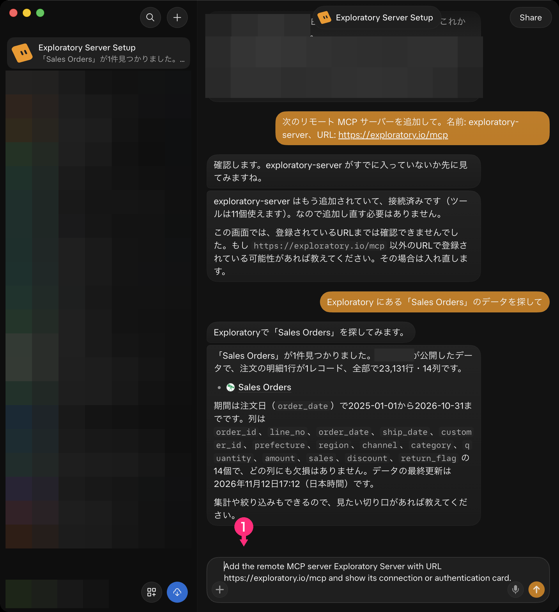

# Connect Grok Bot

After you connect, an AI can read notes and data published on Exploratory. You add the Exploratory server in a Grok Bot chat. Grok Bot is a chat client where you add MCP servers by message.
It takes about 3 minutes. You need an Exploratory account and Grok Bot.

<a id="need"></a>

## Requirements

- An Exploratory account
- Grok Bot
- You do not need an API key or a client ID.

<a id="steps"></a>

## Steps

### Ask it to add the server

This adds the MCP server only; it does not install the skill.

1. In the input field of a Grok Bot chat, type this request and send it.

   ```text
   Add this remote MCP server. Name: exploratory-server, URL: https://exploratory.io/mcp
   ```



The image is an example from an account where the server was already connected. Its input field shows the same request in other words, and Grok Bot answers that the server is already added, so no card appears. On a first connection, the card appears as described next.

### Sign in

Grok Bot shows a card for exploratory-server.

1. Sign in to Exploratory from the card.

When the card says it is connected, check the connection in the next step.

### Try it

1. In a new chat, send this.

   ```text
   Find the "Sales Orders" data on Exploratory.
   ```

### Check the result

1. Check the Sales Orders link in the search result.


If the Sales Orders data appears with its URL, the connection works.

A skill gives an AI instructions for using a service. It is separate from the MCP connection settings.

<a id="trouble"></a>

## Troubleshooting

| What you see | What to do |
| --- | --- |
| You are asked to sign in | Remove the connection and add it again. |

- [Troubleshooting](../troubleshooting.md) - Fixes by symptom for the MCP Server as a whole.

<a id="remove"></a>

## Disconnect

Remove exploratory-server from Grok Bot's connections.

Removing the registration does not revoke the access you approved. To revoke it, also remove the client under Connected AI Apps in your account settings on exploratory.io.
