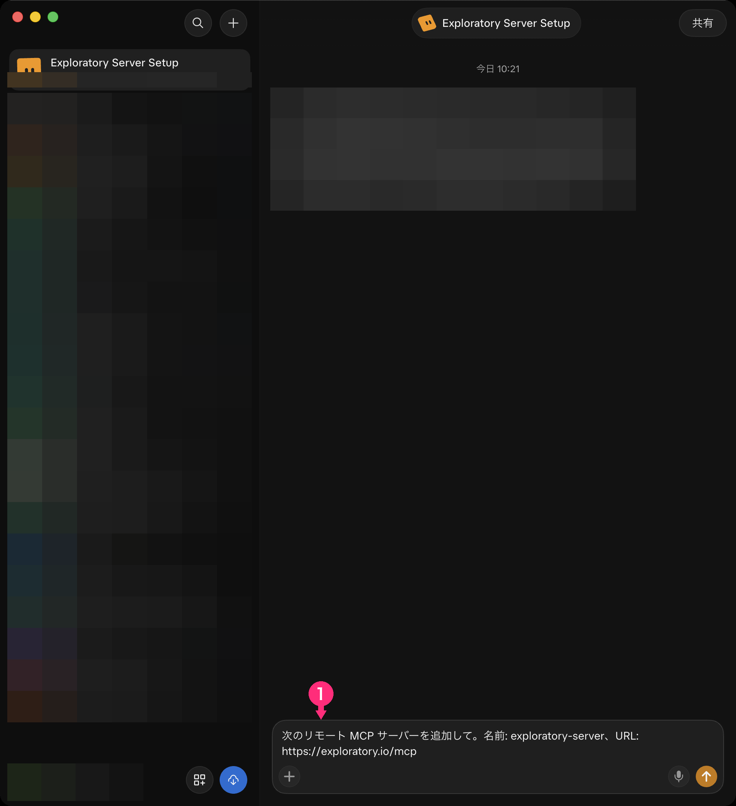
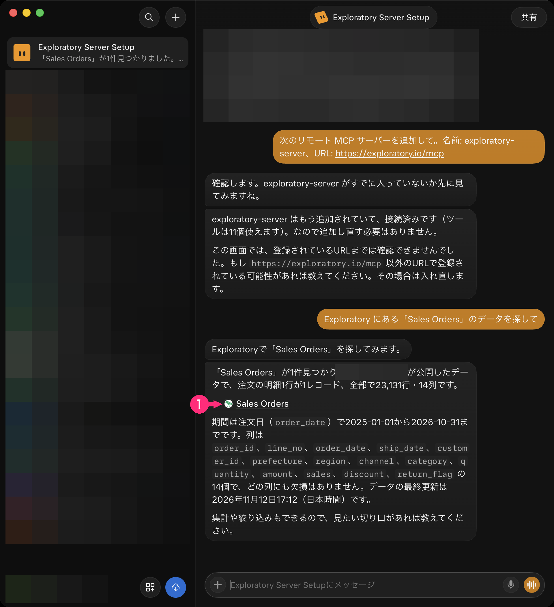

# Grok Bot につなぐ

接続すると、AI から Exploratory に公開されたノートやデータを読めるようになります。Grok Bot のチャットで、Exploratory のサーバーを追加します。Grok Bot は、チャットで MCP サーバーを追加するクライアントです。
かかる時間は 3 分ほどです。Exploratory のアカウントと、Grok Bot を用意してください。

<a id="need"></a>

## 必要なもの

- Exploratory のアカウント
- Grok Bot
- API キーとクライアント ID は必要ありません。

<a id="steps"></a>

## 手順

### 追加を頼む

この方法で追加されるのは MCP サーバーのみで、スキルは含まれません。

1. Grok Bot のチャットの入力欄に、次の依頼を入力して送信します。

   ```text
   次のリモート MCP サーバーを追加して。名前: exploratory-server、URL: https://exploratory.io/mcp
   ```



2. exploratory-server のカードが表示されたら、カードから Exploratory にサインインします。

カードが「接続済み」になったら、次の手順で確認します。

### 試す

1. 新しいチャットで、次のように送信します。

   ```text
   Exploratory にある「Sales Orders」のデータを探して
   ```

続けて、結果を確かめます。

1. 検索結果の「Sales Orders」のリンクを確かめます。



Sales Orders のデータが URL 付きで表示されていれば、接続できています。

スキルは、AI に操作の進め方を教える説明です。MCP の接続設定とは別のものです。

<a id="trouble"></a>

## トラブルシューティング

| 表示される内容 | 対処 |
| --- | --- |
| サインインを求められる | 接続を解除してから、もう一度追加し直します。 |

- [トラブルシューティング](../troubleshooting_ja.md) - MCP Server 全体の、症状ごとの対処です。

<a id="remove"></a>

## 接続を解除する

Grok Bot の接続の一覧から、exploratory-server を削除します。

登録を解除しても、アクセスの許可は残ります。許可も取り消すには、exploratory.io のアカウント設定の「接続中のAIアプリ」から、クライアントを解除します。
